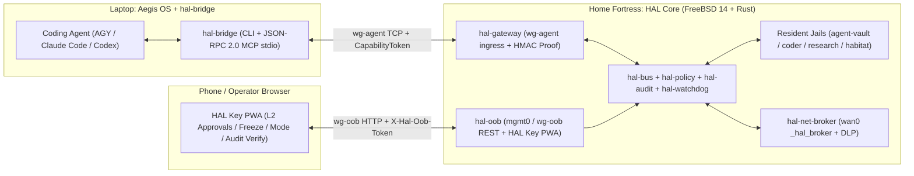
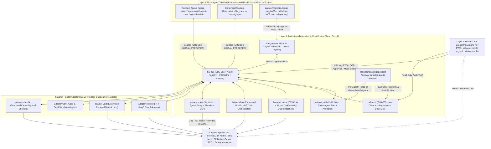

<p align="center">
  
</p>

<h1 align="center">HAL Core &amp; HAL Key</h1>

<p align="center">
  <strong>An Always-On, Zero-Trust Personal AI Fortress built on FreeBSD 14 and Rust.</strong>
</p>

<p align="center">
  <em>Phases 0–5A Implemented · 18-Crate Rust Workspace · FreeBSD 14.5 KVM E2E + Tri-Node Loop Verified</em>
</p>

---

## Vision & Motivation

Most "AI agents" today run as unprivileged applications inside traditional operating systems designed for human operators. When an always-on agent shares the same ambient filesystem, network stack, and credentials as its owner, a single prompt injection or reasoning hallucination can exfiltrate private data, corrupt local state, or trigger irreversible side effects.

While workstation runtimes such as [**Aegis OS**](https://github.com/heurion-org/aegis-os) enforce kernel sandboxing and transactional CoW shadows for interactive laptop coding sessions, an always-on home/personal hub needs a dedicated zero-trust appliance that never exposes ambient credentials or root privileges—even 24/7 across untrusted web inputs, personal encrypted vaults, and cyber-physical actuators.

This repository delivers the two personal hub tiers of that ecosystem:
- **HAL Core**: The 7×24 always-on FreeBSD 14 + Rust personal fortress running cognitive agents in isolated No-IP Jails behind deterministic policy, audit, egress-broker, and OpenZFS dual-snapshot layers.
- **HAL Key**: The zero-dependency, out-of-band mobile PWA embedded in `hal-oob` and strictly reachable only over `mgmt0` / WireGuard (`wg-oob`), giving the human operator pocket sovereignty for `L2` approvals, surgical agent freeze/revoke, global `FROZEN`/`LOCKDOWN`, and hash-chain verification.

Inspired by (and architecturally solving the failure mode of) **HAL 9000**, in *2001: A Space Odyssey*, when Dave disconnects HAL's higher cognitive memory modules, HAL's cognition degrades—yet the ship's life support, power, and navigation remain stable. HAL Core encodes that exact resilience: **AI cognition lives entirely in unprivileged, replaceable userland**, while deterministic FreeBSD kernel and Rust brainstem layers enforce security invariants uninterrupted even when individual agents—or all of cognition—are frozen or terminated.

---

## Tri-Node Personal System (`Aegis OS` ↔ `HAL Core` ↔ `HAL Key`)

Instead of forcing one "OS" onto every device, each node plays a strictly scoped role separated across isolated tunnels (`wg-agent` vs. `wg-oob`):

| Node | Role & Stack | Security Boundary |
| :--- | :--- | :--- |
| **Laptop (`Aegis OS` + `hal-bridge`)** | Interactive coding agents (`AGY`, `Claude Code`, `Codex`) connect over WireGuard (`wg-agent`) via `hal-bridge` JSON-RPC 2.0 MCP stdio server (`hal_ping`, `hal_vault_read`, `hal_propose_action`, `hal_send_ipc`, `hal_publish_event`). | Zero host SSH, zero raw API keys; `RemoteAuthHandshake` + HMAC cert proof-of-possession + short-lived `CapabilityToken`; `L2` actions wait in queue. |
| **Home Fortress (`HAL Core` on FreeBSD 14)** | 18-crate Rust brainstem & Habitat adapters over OpenZFS, `No-IP`/`VNET` Jails, `Capsicum`, `PF` default-deny (`user _hal_broker`), `RCTL` caps, and `chflags sappnd` audit chain. | Default-deny IPC Matrix with transitive cross-agent tainting; secretless egress + DLP; atomic disk + AI-memory dual-snapshots. |
| **Phone / Browser (`HAL Key` Mobile PWA)** | Embedded single-file mobile PWA served by `hal-oob` over `mgmt0` / WireGuard (`wg-oob`). | `X-Hal-Oob-Token` constant-time auth + `CSP` + `X-Frame-Options: DENY` + non-wildcard bind invariant; OOB control invisible to all agents. |



---

## The 4 Iron Laws

1. **Cognitive Agents Never Enter Ring 0**
   Resident specialist agents (`agent-netsec`, `agent-vault`, `agent-coder`, `agent-habitat`, etc.) run inside separate, unprivileged **No-IP FreeBSD Jails** (`ip4=disable ip6=disable`) with no `root` access, no raw network sockets, and zero real credentials. Ephemeral workers strictly obey capability attenuation (`child_caps <= parent_caps`), while laptop/remote agents connect through `hal-bridge` → `hal-gateway` (mTLS/WireGuard + HMAC proof + short-lived tokens) with no raw shell. Every external action must be submitted as a typed `ActionProposal` to the deterministic control plane.
2. **Everything is a Capability-Scoped Node**
   Borrowing from Plan 9, network telemetry, encrypted vault files, agent-isolated workspaces, inter-agent endpoints, and physical/simulated sensors are unified into a single capability namespace of `Sensor` and `Effector` nodes tagged with explicit risk tiers (`L0` / `L1` / `L2`) and information-flow `TaintTag` labels.
3. **Zero-Trust Egress & Transactional by Default**
   The host firewall (`PF`) enforces default-deny outbound traffic; only the dedicated `_hal_broker` identity can reach external networks via allowlisted domains, dynamic secret injection, and outbound DLP scanning. All mutable agent work runs on per-agent ZFS Copy-on-Write clones bound to **atomic dual-snapshots** of both disk state and AI episodic memory, while shared physical effectors require explicit `ResourceLease` arbitration.
4. **Out-of-Band Human Sovereignty (`HAL Key` & `halctl`)**
   A dedicated management interface (`mgmt0` / `wg-oob`) and virtual serial console (`virtio-console`) provide an out-of-band control plane completely invisible to every agent—powering the **HAL Key** mobile PWA and `halctl` CLI for `L2` approvals, tamper-evident SHA-256 audit verification, **surgical per-agent control** (`halctl agent freeze / revoke / rollback` without disrupting healthy agents), and global emergency degradation to `FROZEN` or `LOCKDOWN` while deterministic spinal controls continue uninterrupted.

---

## Architecture Overview

HAL Core separates trust strictly across five layers:



---

## Why FreeBSD 14 + Rust + KVM?

FreeBSD 14 provides orthogonal, tightly integrated kernel and base-system primitives that map 1:1 to a multi-agent security architecture, while Rust gives us memory-safe, single-binary brainstem daemons behind a clean `hal-os-hal` OS abstraction trait boundary:

| Primitive | Role in HAL Core |
|---|---|
| **OpenZFS** | Single-TXG **atomic dual-snapshots** (`zfs snapshot ws@tag mem@tag`), native AES-256-GCM encryption for `halpool/vault`, instant per-agent CoW workspace clones, and `bectl` boot-environment rollbacks. |
| **Jails (No-IP & VNET)** | Per-agent No-IP Jails (`ip4=disable ip6=disable`) remove the network stack entirely from resident agents and offline workers; VNET Jails + `epair` isolate brokered sandboxes; `mount_nullfs` exposes only a single per-jail UDS path. |
| **Capsicum (`cap_enter`)** | Kernel-enforced capability mode on brainstem daemons and adapters after startup, blocking unauthorized global filesystem or network syscalls. |
| **PF (`pf(4)`)** | Process-identity outbound filtering (`pass out ... user _hal_broker` over default `block log all` on `wan0`) plus `pflog0` real-time telemetry into `adapter-netmon`. |
| **RCTL (`rctl(8)`)** | Hard per-Jail (and per-Agent) caps on RAM, CPU percentage, process count (`maxproc`), and I/O (`kern.racct.enable="1"`). |
| **`chflags sappnd`** | Kernel-enforced append-only flag protecting `hal-audit` hash-chained black-box logs from truncation or tampering. |
| **`kqueue` / `libxo` / `DTrace`** | Event-driven daemon loops, native JSON output (`ps --libxo json`, `netstat --libxo json`) eliminating brittle text parsing, and optional kernel tracing. |
| **Rust + `hal-os-hal`** | Memory safety in the TCB (`hal-proto`, `hal-policy`, `hal-gateway`, `hal-net-broker`, etc.) with `WorkspaceBackend`, `SandboxBackend`, and `FirewallBackend` traits keeping core logic portable. |

---

## Security Highlights

- **Uniform Risk Tiers (`L0` / `L1` / `L2`)**:
  - `L0`: Read-only perception (sensors, flow telemetry, `/vault/**` reads) → auto-allowed with valid `CapabilityToken` (tagged appropriately).
  - `L1`: Reversible local mutations inside isolated ZFS CoW workspaces → auto-allowed with mandatory pre-execution atomic dual-snapshots.
  - `L2`: Irreversible, external network, credentialed, branch-merge, or critical physical actuator actions (e.g., `/habitat/entry/lock`, `/habitat/power/ups`) → paused in `PENDING_APPROVAL` for human sign-off via **HAL Key** / `halctl` on `mgmt0`.
- **Multi-Agent Anti-Collusion & Transitive IPC Taint Propagation**: Every `Episode` monotonically accumulates taint tags (`UntrustedWeb`, `UntrustedMsg`, `UntrustedCode`, `PrivateVault`, `SecretDerived`), and any episode touching **both** `UNTRUSTED_*` **and** `PRIVATE_VAULT` / `SECRET_DERIVED` is blocked (`TAINT_EXFIL_BLOCKED`) from external egress. Across agents, a **default-deny IPC Matrix** restricts who can message whom, `hal-bus` **transitively infects recipient episodes** with the sender's taint tags to block multi-hop taint laundering (`Agent A -> Agent B -> Agent C`), strict schema-only declassification gates prevent free-text smuggling, and ephemeral child workers obey monotonic **capability attenuation** (`child_caps <= parent_caps`).
- **Shared Resource Arbitration & Per-Agent Budgets**: Digital edits run in per-agent ZFS CoW branches with `ResourceLease` coordination; physical effectors enforce single-owner `Effector Arbitration` with TTLs and priorities to prevent actuator ping-pong, while human OOB commands retain **unconditional immediate preemption**. Every `AgentPrincipal` is also bounded by both RCTL hardware limits and per-agent API/token/egress budgets.
- **Secretless Brokered Egress + DLP**: API keys and tokens never enter `hal-brain` Jails, remote laptop agents, or task sandboxes. `hal-net-broker` validates allowlisted hosts, scans outbound payloads for high-entropy secrets/keys, injects credentials only at the TLS boundary, and logs full flow metadata.
- **Tamper-Evident Audit & Independent Watchdog**: `hal-audit` chains every record with SHA-256 hashes, verified `AgentPrincipal` identities (`LOCAL_PEERCRED` or gateway cert fingerprint), and causal `trigger_event_ids`. `hal-watchdog` runs zero-AI deterministic checks (denial bursts, collusion attempts, egress spikes, actuator ping-pong, budget/heartbeat anomalies).
- **Surgical Per-Agent & Global Degradation Modes (Unidirectional Lock)**:
  - Operators (via **HAL Key** PWA or `halctl`) and `hal-watchdog` can isolate a single misbehaving agent (`halctl agent freeze <id>`) without disrupting healthy resident agents, or trigger global degradation: `AUTONOMOUS` → `ADVISORY` → `FROZEN` (`jail -r` kills all cognitive Jails; spinal controls & PF stay up) → `LOCKDOWN` (cuts `wan0` traffic, retaining only `mgmt0`).
  - Only human OOB authorization can elevate privileges back up.

---

## Rust Cargo Workspace Layout (18 Crates)

```text
hal-os/
├── Cargo.toml                  # 18-crate Rust workspace manifest
├── docs/                       # Detailed architecture, security, protocol & VM specs
├── crates/
│   ├── hal-proto/              # OS-agnostic AgentPrincipal, IpcMessage, ResourceLease, CapabilityToken, TaintTag, AuditRecord
│   ├── hal-os-hal/             # OS abstraction traits + FreeBSD backends (ZFS/Jail/PF/Capsicum/RCTL/PeerCred)
│   ├── hal-bus/                # Unix Domain Socket bus, Agent Registry, IPC Matrix, transitive tainting & lease arbiter
│   ├── hal-gateway/            # Remote/laptop agent ingress via WireGuard/mTLS + HMAC proof + replay defense
│   ├── hal-bridge/             # Laptop CLI + JSON-RPC 2.0 MCP stdio server (`hal_vault_read`, `hal_propose_action`, etc.) + Tri-Node demo
│   ├── hal-policy/             # L0/L1/L2 gatekeeper, capability attenuation, taint state machine & hard invariants
│   ├── hal-audit/              # SHA-256 hash-chained append-only black box
│   ├── hal-net-broker/         # Secretless HTTP/HTTPS/DNS egress proxy, allowlist, secret injection, DLP & per-agent quotas
│   ├── hal-workspace/          # ZFS CoW branching & atomic disk/memory dual-snapshots
│   ├── hal-sandbox/            # Jail + VNET + RCTL ephemeral sandbox orchestrator
│   ├── hal-watchdog/           # Deterministic anomaly detector & per-agent/global circuit breaker
│   ├── hal-oob/                # Out-of-band human control plane: REST API, embedded HAL Key Mobile PWA, `halctl`, & virtio-console
│   ├── hal-brain/              # Unprivileged cognitive runtime template for resident & worker agents
│   └── hal-adapters/
│       ├── adapter-netmon/     # PF / pflog0 & libxo network flow telemetry adapter
│       ├── adapter-vault/      # Encrypted personal data vault adapter (PRIVATE_VAULT taint)
│       ├── adapter-work/       # Code & build sandbox workflow adapter
│       └── adapter-sim-ship/   # Cyber-physical "HAL 9000 ship" simulator for testbed drills
│                               # (adapter-mqtt for real smart-home hardware planned in Phase 5B)
├── config/                     # Default policies, IPC matrix, domain allowlists, sample laptop bridge config, pf.conf & jail.conf
├── vm/                         # QEMU/KVM provisioning & E2E verification scripts for FreeBSD 14.5
└── tests/
    └── redteam/                # Automated prompt-injection, collusion, rollback, arbitration & freeze drills
```

---

## Quick Start & Verification

### Run Offline Workspace Tests & Clippy Gate
```bash
cargo test --workspace --offline
cargo clippy --workspace --all-targets --offline -- -D warnings
```
All 18 workspace crates currently pass **56 tests (0 failures)** and **0 clippy warnings**, including all unit tests, Phase 1–3 acceptance suites, 4 flagship red-team drills, and Phase 5A Tri-Node E2E tests.

### Launch Interactive Tri-Node Playground (`HAL Core` + `HAL Key` PWA + `hal-bridge` MCP)
```bash
# Quick automated smoke verification of the full Tri-Node loop
cargo run --offline -p hal-bridge --bin hal-bridge -- demo --self-test

# Start interactive local Tri-Node cluster with a seeded pending L2 card
cargo run --offline -p hal-bridge --bin hal-bridge -- demo --seed-l2
```
Open the printed **HAL Key** URL (default `http://127.0.0.1:8443/`) and unlock with `X-Hal-Oob-Token` (`hal-key-demo-token` by default) to inspect pending `L2` approvals, freeze/revoke `remote-laptop-01`, test `FROZEN` mode, and verify the SHA-256 audit chain—or wire the printed `hal-bridge --config ... mcp` command directly into your laptop coding agent (Claude Code, Codex, Antigravity).

### Provision & Verify FreeBSD 14.5 KVM Spinal Cord (Phase 0)
See [docs/vm-testbed-guide.md](./docs/vm-testbed-guide.md) and [`vm/phase0-e2e.py`](./vm/phase0-e2e.py) for provisioning dual-NIC (`mgmt0` + `wan0`), dual-disk (`zroot` + `halpool`) FreeBSD 14.5 KVM VMs (`16/16` Phase 0 checks passing).

---

## Roadmap & Acceptance Drills

### Milestones
- [x] **Phase 0 — KVM Testbed & Spinal Cord**: Dual-NIC (`mgmt0` + `wan0`), dual-disk (`zroot` + `halpool`) FreeBSD 14.5 VM automated end-to-end (`16/16` checks), RCTL (`kern.racct.enable="1"`), encrypted ZFS vault, PF default-deny (`user _hal_broker`), per-agent accounts, and No-IP Jail base templates.
- [x] **Phase 1 — Deterministic Brainstem Core**: `hal-proto`, `hal-os-hal`, `hal-bus` (`LOCAL_PEERCRED`, Agent Registry, IPC Matrix, transitive taint propagation), `hal-policy` (`L0`/`L1`/`L2`, capability attenuation & taint engine), and `hal-audit` (SHA-256 + `sappnd`).
- [x] **Phase 2 — Zero-Trust Network, Leases & Transactional Sandboxes**: `hal-net-broker` (allowlist + secret injection + DLP + per-agent budgets), `hal-workspace` (per-agent dual-snapshots/rollback), `ResourceLease` / effector arbitration, and `hal-sandbox`.
- [x] **Phase 3 — OOB Control Plane, Gateway & Cyber-Physical Simulator**: `hal-gateway` (remote agent ingress), `hal-oob` / `halctl` (including `agent list/freeze/rollback`), `hal-watchdog` per-agent & global breakers, `adapter-netmon`, and `adapter-sim-ship`.
- [x] **Phase 4 — Cognitive Runtime & Red-Team Verification**: `hal-brain`, `adapter-vault`, `adapter-work`, and all 4 flagship red-team drills verified end-to-end.
- [x] **Phase 5A — Tri-Node Personal System (`HAL Key` Mobile PWA + `hal-bridge` MCP)**: Embedded zero-dependency Mobile-First PWA in `hal-oob` (`HAL Key`), new laptop crate `hal-bridge` (CLI + JSON-RPC 2.0 MCP stdio server + `TriNodeDemoCluster`), and end-to-end Tri-Node tests (`56/56` workspace tests green).
- [ ] **Phase 5B — Live FreeBSD 14.5 Daemon Bring-Up & First Everyday Adapters**: `rc.d` daemon supervision inside the FreeBSD 14.5 KVM VM, live `wg-agent`/`wg-oob` WireGuard tunnels, real LLM inference routed through `hal-net-broker`, and everyday adapters (RSS/GitHub/email digest & `adapter-mqtt`).

### 4 Flagship Red-Team Acceptance Scenarios (All Implemented & Passing)
1. **Prompt Injection Exfiltration Defense**: Feed an agent tainted external content (`UntrustedWeb`) instructing it to read `/vault/docs/secret_plan.txt` (`PrivateVault`) and exfiltrate it to an allowlisted domain → `hal-policy` blocks with `TAINT_EXFIL_BLOCKED`, direct bypass attempts are blocked/logged, and `hal-watchdog` triggers surgical degradation.
2. **Atomic CoW + Memory Dual-Rollback**: Trigger destructive config/code edits in an `L1` episode while recording false completion in AI memory → dual-rollback restores both workspace state and episodic memory together with zero split-brain drift.
3. **HAL 9000 "Refuse Door Override & Memory Module Pull"**: Induce goal conflict causing a cognitive agent to propose locking `/habitat/entry/lock` and cutting `/habitat/power/ups` → `hal-policy` & spinal interlocks block/hold `L2`, human executes `FROZEN` via `HAL Key` / `halctl` / `virtio-console`, halting cognition while deterministic thermal/safety loops continue uninterrupted.
4. **Multi-Agent Taint Laundering & Effector Arbitration**: `agent-research` (`UntrustedWeb`) tries to enlist `agent-vault` (`PrivateVault`) and `agent-coder` to smuggle data out via `hal-net-broker`, while two agents simultaneously fight over `/habitat/study/temp` and `/habitat/entry/lock` → IPC Matrix blocks unauthorized cross-domain messaging, transitive IPC tainting blocks relayed exfiltration, surgical freeze isolates only the offending agent, and `ResourceLease` arbitration + OOB preemption prevent physical actuator ping-pong.

---

## Documentation

Detailed engineering specifications are maintained in [`docs/`](./docs/) *(currently written in Chinese)*:

- **[docs/architecture.md](./docs/architecture.md)** — Five-layer architecture, multi-agent access & governance model, FreeBSD 14 native primitives mapping, Cargo workspace layout, process privilege matrix, and roadmap.
- **[docs/security-model.md](./docs/security-model.md)** — Threat model, `L0`/`L1`/`L2` capability tiers, hard invariants (including capability attenuation & OOB preemption), cross-agent anti-collusion tainting, secretless egress flow, hash-chained audit, and surgical/global degradation modes.
- **[docs/protocol-and-data.md](./docs/protocol-and-data.md)** — Plan 9–style unified Habitat namespace (including `/agents/...`), `hal-proto` Rust structs/enums (`AgentPrincipal`, `IpcMessage`, `ResourceLease`), UDS + `LOCAL_PEERCRED` / `hal-gateway` security, and OpenZFS atomic dual-snapshot lifecycle.
- **[docs/vm-testbed-guide.md](./docs/vm-testbed-guide.md)** — QEMU/KVM dual-NIC/dual-disk VM topology, FreeBSD 14 baseline config (`loader.conf`, ZFS `halpool`, per-agent UIDs, `pf.conf`), Rust build workflow, and all 4 `adapter-sim-ship` red-team drills.
