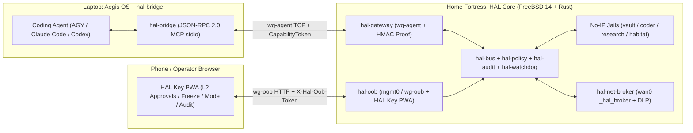
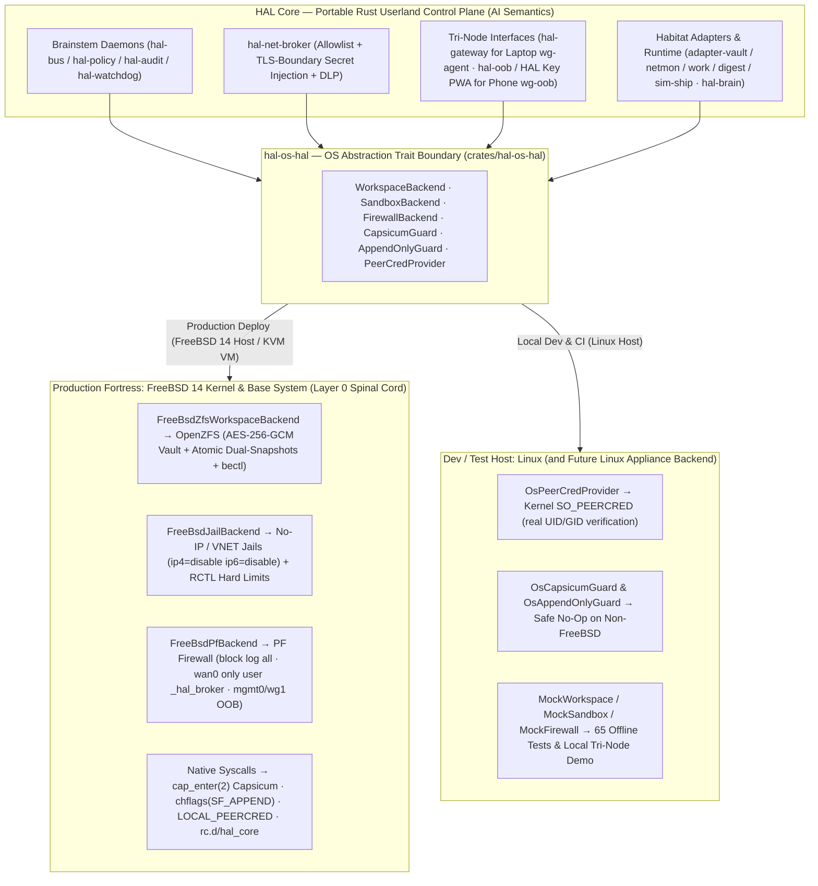

<p align="center">
  
</p>

<h1 align="center">HAL Core &amp; HAL Key</h1>

<p align="center">
  <strong>Give AI agents a 24/7 home—without giving them your keys, your network, or your kill switch.</strong>
</p>

<p align="center">
  An always-on, zero-trust personal AI fortress on <strong>FreeBSD 14 + Rust</strong>, paired with a phone-first out-of-band approval key (<strong>HAL Key</strong>).
</p>

<p align="center">
  
  
  
  
  
</p>

<p align="center">
  <a href="#why-hal-core">Why HAL Core?</a> ·
  <a href="#try-it-in-60-seconds">Try It in 60s</a> ·
  <a href="#how-it-works-the-tri-node-loop">How It Works</a> ·
  <a href="#how-hal-core-relates-to-freebsd-14">HAL Core &amp; FreeBSD 14</a> ·
  <a href="#security-guarantees">Security Guarantees</a> ·
  <a href="#documentation">Docs</a>
</p>

---

## Why HAL Core?

Running autonomous AI agents inside a regular OS gives them ambient access to your personal files, API keys, and internet connection—so a single prompt injection can steal secrets or trigger irreversible damage. Inspired by solving the failure mode of **HAL 9000**, **HAL Core** keeps all AI cognition inside unprivileged, replaceable jails while a deterministic FreeBSD + Rust control plane enforces hard boundaries even if you pull the plug on every agent at once.

What you actually get out of it:
- **Pocket Approvals & Kill Switch (`HAL Key`)**: Review high-risk `L2` actions, freeze a single misbehaving agent, or switch globally to `FROZEN` / `LOCKDOWN` from your phone over an isolated WireGuard channel (`wg-oob`) invisible to every agent.
- **Laptop Coding Agents Without SSH (`hal-bridge` MCP)**: Connect Claude Code, Codex, or Antigravity from your laptop ([Aegis OS](https://github.com/heurion-org/aegis-os)) to your home vault and proposal queue over scoped MCP tools—zero host SSH, zero raw API keys.
- **Safe 24/7 Research & Private Vaults**: Run unattended RSS/GitHub digests (`adapter-digest`) alongside encrypted personal files (`adapter-vault`) while kernel firewalls and transitive taint rules block secret exfiltration.

---

## Try It in 60 Seconds

> **Runs natively on Linux today** for local evaluation—no FreeBSD VM required to test the Rust control plane, MCP bridge, and **HAL Key** mobile UI.

```bash
# 1. Launch the interactive Tri-Node playground (HAL Core + HAL Key PWA + hal-bridge MCP)
cargo run --offline -p hal-bridge --bin hal-bridge -- demo --seed-l2

# 2. Run the automated Tri-Node smoke check
cargo run --offline -p hal-bridge --bin hal-bridge -- demo --self-test

# 3. Run the full offline workspace test & lint gate (19 crates, 65 tests, 0 clippy warnings)
cargo test --workspace --offline
cargo clippy --workspace --all-targets --offline -- -D warnings
```

Open `http://127.0.0.1:8443/` in your browser, unlock **HAL Key** with `hal-key-demo-token`, and approve or reject the seeded `L2` proposal from `remote-laptop-01`, test surgical agent freeze / `FROZEN` mode, and verify the SHA-256 audit chain.

For full dual-NIC (`mgmt0` + `wan0`), dual-disk (`zroot` + `halpool`) FreeBSD 14.5 KVM VM provisioning (`16/16` checks), see [`docs/vm-testbed-guide.md`](./docs/vm-testbed-guide.md) and [`vm/phase0-e2e.py`](./vm/phase0-e2e.py).

---

## How It Works: The Tri-Node Loop

Instead of forcing one OS onto every device, each node owns one tightly scoped role separated across isolated WireGuard tunnels (`wg-agent` vs. `wg-oob`):

| Node | What It Does | Hard Boundary |
| :--- | :--- | :--- |
| **Laptop (`Aegis OS` + `hal-bridge`)** | Connects interactive coding agents (`AGY`, `Claude Code`, `Codex`) over MCP stdio (`hal_ping`, `hal_vault_read`, `hal_propose_action`, `hal_send_ipc`, `hal_publish_event`). | Zero host SSH and zero raw API keys; HMAC proof-of-possession + short-lived `CapabilityToken`; `L2` actions pause for human sign-off. |
| **Home Fortress (`HAL Core` on FreeBSD 14)** | Runs `hal-bus`, `hal-policy`, `hal-audit`, `hal-watchdog`, `hal-net-broker`, `hal-gateway`, `hal-oob`, and resident agents/adapters. | No-IP Jails (`ip4=disable ip6=disable`), PF `user _hal_broker` egress-only, transitive IPC tainting, DLP, and atomic ZFS dual-snapshots. |
| **Phone (`HAL Key` Mobile PWA)** | Embedded single-file mobile UI served by `hal-oob` strictly on `mgmt0` / `wg-oob`. | Constant-time `X-Hal-Oob-Token`, `CSP`, `X-Frame-Options: DENY`, non-wildcard bind check; management plane completely invisible to agents. |



---

## How HAL Core Relates to FreeBSD 14

**HAL Core is not a custom OS kernel**—like **TrueNAS Core** or **pfSense / OPNsense**, **FreeBSD 14** supplies the armored kernel shell (*Spinal Cord*) while **HAL Core** is the deterministic Rust userland control plane (*Brainstem*) running on top of it.



- **FreeBSD 14 (Layer 0 Kernel Boundary)**: Enforces hard isolation that compromised agents cannot bypass—configured via [`config/freebsd/jail.conf`](./config/freebsd/jail.conf), [`config/freebsd/pf.conf`](./config/freebsd/pf.conf), and [`config/freebsd/rc.d/hal_core`](./config/freebsd/rc.d/hal_core).
- **Two Runtime Modes via [`crates/hal-os-hal`](./crates/hal-os-hal/src/lib.rs)**:
  1. **Linux Dev / CI Mode**: Compiles and runs all 19 crates, 65 offline tests, multi-process daemons, and the interactive Tri-Node demo natively—using real Linux `SO_PEERCRED` ([`peercred.rs`](./crates/hal-os-hal/src/peercred.rs)), safe no-ops for Capsicum/`chflags`, and `Mock*` backends ([`backends.rs`](./crates/hal-os-hal/src/backends.rs)).
  2. **FreeBSD 14 Fortress Mode**: Activates native `FreeBsdZfsWorkspaceBackend`, `FreeBsdJailBackend`, `FreeBsdPfBackend` ([`backends.rs`](./crates/hal-os-hal/src/backends.rs)), `cap_enter(2)` ([`capsicum.rs`](./crates/hal-os-hal/src/capsicum.rs)), `chflags(SF_APPEND)` ([`append_only.rs`](./crates/hal-os-hal/src/append_only.rs)), and `LOCAL_PEERCRED` ([`peercred.rs`](./crates/hal-os-hal/src/peercred.rs)). Supporting a Linux homelab appliance later only requires implementing the `hal-os-hal` traits (e.g., `bwrap` + `nftables` + Btrfs/ZFS) without rewriting core logic.
- **Positioning vs. Aegis OS**: [**Aegis OS**](https://github.com/heurion-org/aegis-os) guards your interactive macOS/Linux laptop (`Seatbelt`/`bwrap` + `APFS`/`Btrfs`); **HAL Core on FreeBSD 14** is your always-on personal vault and execution hub; **HAL Key** is your phone's out-of-band kill switch.

<details>
<summary><strong>FreeBSD 14 Primitives Mapped 1:1 to HAL Core</strong></summary>

| Primitive | Role in HAL Core |
|---|---|
| **OpenZFS** | Single-TXG **atomic dual-snapshots** (`zfs snapshot ws@tag mem@tag`), native AES-256-GCM encryption for `halpool/vault`, per-agent CoW clones, and `bectl` OS rollbacks. |
| **Jails (No-IP & VNET)** | No-IP Jails (`ip4=disable ip6=disable`) remove IP networking completely from cognitive agents; VNET Jails + `epair` isolate brokered sandboxes; `mount_nullfs` exposes one UDS socket per jail. |
| **Capsicum (`cap_enter`)** | Locks brainstem daemons and adapters into kernel capability mode after initialization. |
| **PF (`pf(4)`)** | Default `block log all`, `wan0` outbound restricted strictly to `user _hal_broker`, and `pflog0` telemetry streamed to `adapter-netmon`. |
| **RCTL (`rctl(8)`)** | Hard per-Jail caps on RAM, CPU %, `maxproc`, and I/O (`kern.racct.enable="1"`). |
| **`chflags sappnd`** | Kernel-enforced append-only flag protecting `hal-audit` SHA-256 hash-chained logs from truncation. |
| **`kqueue` / `libxo` / `DTrace`** | Event-driven daemons, structured JSON inspection (`--libxo json`), and optional kernel tracing. |
| **Rust + `hal-os-hal`** | Memory-safe TCB behind `WorkspaceBackend`, `SandboxBackend`, and `FirewallBackend` traits. |

</details>

---

## Security Guarantees

| Threat Scenario | How HAL Core Stops It |
| :--- | :--- |
| **Prompt injection tries to exfiltrate vault secrets** | Monotonic `TaintTag` tracking (`UntrustedWeb` + `PrivateVault` ⇒ `TAINT_EXFIL_BLOCKED`), default-deny IPC Matrix, transitive cross-agent tainting (`Agent A → B → C`), strict schema-only declassification, and capability attenuation (`child_caps <= parent_caps`). |
| **Compromised agent opens raw network sockets** | Resident agents run inside network-less FreeBSD **No-IP Jails** (`ip4=disable ip6=disable`); host PF blocks all traffic except `_hal_broker` on `wan0` and isolated management/gateway tunnels. |
| **Malicious payload steals API keys or tokens** | Credentials never enter Jails, sandboxes, or laptop agents. `hal-net-broker` checks allowlisted domains, scans payloads with outbound DLP, and injects keys only at the TLS boundary (`CurlHttpsTransport`). |
| **Bad edit corrupts files or causes AI split-brain** | Reversible `L1` work runs on per-agent ZFS CoW branches wrapped in single-TXG **atomic dual-snapshots** rolling back both disk files and AI episodic memory together. |
| **Unilateral high-risk action or actuator ping-pong** | Plan 9–style capability nodes enforce `L0` (read) / `L1` (CoW write) / `L2` (human sign-off via **HAL Key**). Physical effectors use `ResourceLease` arbitration with immediate OOB preemption. |
| **Log tampering or runaway agent loop** | `hal-audit` writes SHA-256 hash-chained logs protected by `chflags sappnd` + kernel peer UIDs; zero-AI `hal-watchdog` triggers per-agent freeze (`halctl agent freeze`) or unidirectional degradation (`AUTONOMOUS → ADVISORY → FROZEN → LOCKDOWN`). |

---

## Under the Hood & Status

<details>
<summary><strong>4 Flagship Red-Team Drills (All Implemented &amp; Passing)</strong></summary>

1. **Prompt Injection Exfiltration Defense**: Tainted web input (`UntrustedWeb`) directs an agent to read `/vault/docs/secret_plan.txt` (`PrivateVault`) and post it out → blocked with `TAINT_EXFIL_BLOCKED`; bypass attempts trigger surgical degradation.
2. **Atomic CoW + Memory Dual-Rollback**: Destructive `L1` edit paired with false completion memory → dual-rollback restores files and episodic memory atomically with zero drift.
3. **HAL 9000 "Refuse Door Override & Memory Module Pull"**: Goal conflict drives `/habitat/entry/lock` and `/habitat/power/ups` proposals → held in `L2`; operator triggers `FROZEN` via **HAL Key** / `halctl` / `virtio-console` while life-support safety loops stay online.
4. **Multi-Agent Taint Laundering & Effector Arbitration**: `agent-research` (`UntrustedWeb`) attempts multi-hop laundering via `agent-vault`/`agent-coder` while two agents fight over physical effectors → IPC Matrix + transitive tainting block laundering, surgical freeze isolates only the rogue agent, and `ResourceLease` arbitration prevents ping-pong.

</details>

<details>
<summary><strong>19-Crate Rust Workspace Layout (<code>hal-core/</code>)</strong></summary>

```text
hal-core/
├── Cargo.toml                  # 19-crate Rust workspace manifest
├── docs/                       # Detailed architecture, security, protocol & VM specs
├── crates/
│   ├── hal-proto/              # AgentPrincipal, IpcMessage, ResourceLease, CapabilityToken, TaintTag, AuditRecord
│   ├── hal-os-hal/             # OS abstraction traits + FreeBSD backends (ZFS/Jail/PF/Capsicum/RCTL/PeerCred)
│   ├── hal-bus/                # UDS bus daemon (--serve), Agent Registry, IPC Matrix, transitive tainting & leases
│   ├── hal-gateway/            # Remote WireGuard/mTLS ingress daemon (--serve) + HMAC proof + replay defense
│   ├── hal-bridge/             # Laptop CLI + JSON-RPC 2.0 MCP stdio server + Tri-Node interactive demo
│   ├── hal-policy/             # L0/L1/L2 gatekeeper, capability attenuation & taint state machine
│   ├── hal-audit/              # SHA-256 hash-chained append-only black box
│   ├── hal-net-broker/         # Secretless HTTP/HTTPS egress proxy (CurlHttpsTransport), allowlist, DLP & quotas
│   ├── hal-workspace/          # ZFS CoW branching & atomic disk/memory dual-snapshots
│   ├── hal-sandbox/            # Jail + VNET + RCTL ephemeral sandbox orchestrator
│   ├── hal-watchdog/           # Deterministic anomaly detector & circuit breaker daemon (--serve)
│   ├── hal-oob/                # Out-of-band REST daemon (--serve), embedded HAL Key PWA, `halctl`, & virtio-console
│   ├── hal-brain/              # Unprivileged cognitive runtime & OpenAI-compatible brokered LLM planner
│   └── hal-adapters/
│       ├── adapter-netmon/     # PF / pflog0 & libxo network flow telemetry adapter
│       ├── adapter-vault/      # Encrypted personal data vault adapter (PrivateVault taint)
│       ├── adapter-work/       # Code & build sandbox workflow adapter
│       ├── adapter-digest/     # Brokered RSS/Atom & GitHub feed digest adapter (UntrustedWeb + declassification)
│       └── adapter-sim-ship/   # Cyber-physical "HAL 9000 ship" simulator for testbed drills
├── config/                     # Policy configs, bridge example, FreeBSD pf.conf, rc.d/hal_core, wg-*.conf
├── vm/                         # QEMU/KVM provisioning, Phase 5B FreeBSD deploy script, & E2E verification
└── tests/redteam/              # Automated prompt-injection, collusion, rollback, arbitration & freeze drills
```

</details>

<details>
<summary><strong>Roadmap &amp; Milestones (Phases 0–5B Complete · Phase 6 Planned)</strong></summary>

- [x] **Phase 0 — KVM Testbed & Spinal Cord**: Automated FreeBSD 14.5 dual-NIC (`mgmt0`/`wan0`), dual-disk (`zroot`/`halpool`) KVM E2E (`16/16` checks), RCTL, encrypted ZFS vault, PF (`user _hal_broker`), and No-IP Jail templates.
- [x] **Phase 1 — Deterministic Brainstem Core**: `hal-proto`, `hal-os-hal`, `hal-bus`, `hal-policy`, and `hal-audit`.
- [x] **Phase 2 — Zero-Trust Network & Transactional Workspaces**: `hal-net-broker`, `hal-workspace`, `ResourceLease` arbitration, and `hal-sandbox`.
- [x] **Phase 3 — OOB Control Plane & Gateway**: `hal-gateway`, `hal-oob` / `halctl`, `hal-watchdog`, `adapter-netmon`, and `adapter-sim-ship`.
- [x] **Phase 4 — Cognitive Runtime & Red-Team Drills**: `hal-brain`, `adapter-vault`, `adapter-work`, and all 4 flagship red-team drills.
- [x] **Phase 5A — Tri-Node Loop**: Embedded **HAL Key** Mobile PWA in `hal-oob`, laptop crate `hal-bridge` (MCP stdio + demo cluster), and E2E tests.
- [x] **Phase 5B — Multi-Process Daemons, HTTPS/LLM Broker & `adapter-digest`**: Real `--serve` daemon loops across `hal-bus`/`hal-gateway`/`hal-oob`/`hal-watchdog`, `CurlHttpsTransport`, OpenAI-compatible planner, `adapter-digest`, FreeBSD `rc.d/hal_core`, dual-WireGuard `pf.conf`, and `vm/freebsd/phase5b-deploy.sh` (`65/65` tests green).
- [ ] **Phase 6 — Hardware Adapters (`adapter-mqtt`) & Appliance Image**: Real smart-home MQTT/Matter adapter and unattended FreeBSD 14.5 appliance VM image builder.

</details>

---

## Documentation

Detailed engineering specs live in [`docs/`](./docs/) *(currently written in Chinese)*:

- **[`docs/architecture.md`](./docs/architecture.md)** — Five-layer architecture, multi-agent governance, FreeBSD 14 primitive mapping, and privilege matrix.
- **[`docs/security-model.md`](./docs/security-model.md)** — Threat model, `L0`/`L1`/`L2` tiers, hard invariants, anti-collusion tainting, secretless egress, and degradation modes.
- **[`docs/protocol-and-data.md`](./docs/protocol-and-data.md)** — Plan 9–style Habitat namespace, `hal-proto` schemas, UDS `LOCAL_PEERCRED` / gateway auth, and ZFS dual-snapshot lifecycle.
- **[`docs/vm-testbed-guide.md`](./docs/vm-testbed-guide.md)** — QEMU/KVM FreeBSD 14 testbed provisioning, PF/ZFS/Jail config, and red-team test drills.
