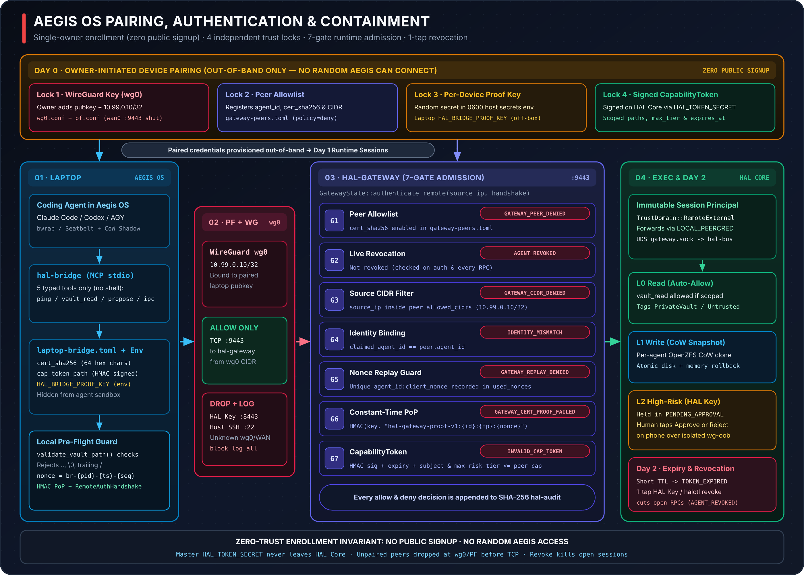
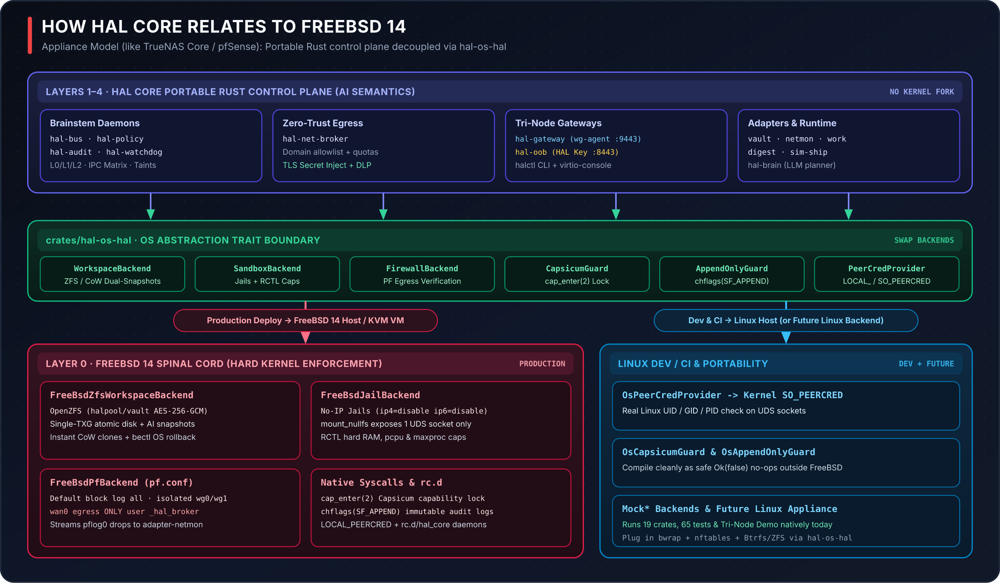

<p align="center">
  
</p>

<h1 align="center">HAL Core &amp; HAL Key</h1>

<p align="center">
  <strong>Give AI agents a 24/7 home—without giving them your keys, your network, or your kill switch.</strong>
</p>

<p align="center">
  An always-on, zero-trust personal AI fortress on <strong>FreeBSD 14 + Rust</strong>, paired with a phone-first out-of-band approval key (<strong>HAL Key</strong>).
</p>

<p align="center">
  
  
  
  
  
</p>

<p align="center">
  <a href="#why-hal-core">Why HAL Core?</a> ·
  <a href="#quick-start">Quick Start</a> ·
  <a href="#connect-your-ai-coding-agent-mcp">MCP Agent Setup</a> ·
  <a href="#deploy-on-freebsd-14-production">FreeBSD 14 Deploy</a> ·
  <a href="#architecture-and-security">Architecture &amp; Auth</a> ·
  <a href="#how-hal-core-relates-to-freebsd-14">FreeBSD Design</a> ·
  <a href="#documentation">Docs</a>
</p>

---

## Why HAL Core?

Running autonomous AI agents directly on a normal OS gives them ambient access to your personal files, API keys, and internet connection—so one prompt injection can leak secrets or run destructive actions. Inspired by solving the failure mode of **HAL 9000**, **HAL Core** isolates AI cognition in unprivileged workspaces while a deterministic Rust + FreeBSD control plane holds the keys, approvals, and kill switch:

- **Pocket Approvals & Kill Switch (`HAL Key`)**: Approve or reject high-risk `L2` actions, freeze a single rogue agent, or drop the entire system to `FROZEN` / `LOCKDOWN` over a management-only channel (`wg-oob`) invisible to agents.
- **Scoped Laptop Coding Agents (`hal-bridge` MCP)**: Connect Claude Code, Codex, or Antigravity ([Aegis OS](https://github.com/heurion-org/aegis-os)) over 5 typed MCP tools—**no SSH, no raw API keys, no open signup**.
- **24/7 Safe Research & Vault**: Run RSS/GitHub digests (`adapter-digest`) alongside encrypted personal files (`adapter-vault`) while taint tracking, DLP, and firewalls prevent secret exfiltration.

---

## Prerequisites

| Goal | What You Need |
| :--- | :--- |
| **Local evaluation & testing (Linux / macOS / FreeBSD)** | Git + Rust toolchain (`rustc` / `cargo`, edition 2021). **No FreeBSD VM or WireGuard required.** |
| **Production appliance deployment** | FreeBSD 14.x (bare metal or KVM/QEMU VM), OpenZFS, PF, WireGuard, plus Rust toolchain to build binaries. |

---

## Quick Start

Pick one of the two paths below:
- **Option A** launches everything in one command with pre-seeded demo credentials (`60s`).
- **Option B** walks step-by-step through real device enrollment (`halctl peer enroll`), laptop pairing (`hal-bridge pair`), approval, token renewal, and revocation on localhost.

### Option A · 60-Second Interactive Playground (Zero Setup)

```bash
git clone https://github.com/0xSynapse/hal-core.git
cd hal-core

# Start the in-process Tri-Node cluster (HAL Core + HAL Key UI + sample L2 proposal)
cargo run -p hal-bridge --bin hal-bridge -- demo --seed-l2
```

What happens next:
1. Wait until the terminal prints `HAL Core + HAL Key Tri-Node Demo Running`.
2. Open **`http://127.0.0.1:8443/`** in your browser and sign in with token **`hal-key-demo-token`**.
3. You will see a seeded **`L2` approval request** from `remote-laptop-01` — click **Approve** or **Reject**, or test **Freeze Agent** / **Switch Mode (`FROZEN`)**.
4. *(Optional)* In a **second terminal**, send another proposal from the simulated laptop bridge:
   ```bash
   cargo run -p hal-bridge --bin hal-bridge -- \
     --config /tmp/hal-trinode-demo/laptop-bridge.toml \
     propose --target /habitat/entry/lock --action lock --args '{"locked":true}' --reason "manual check"
   ```
5. Press `Ctrl+C` in the first terminal when finished, or run the headless automated demo self-test:
   ```bash
   cargo run -p hal-bridge --bin hal-bridge -- demo --self-test
   # Expected: TRINODE_SELF_TEST_OK
   ```

---

### Option B · Real Local Device Pairing Walkthrough (Step by Step)

Follow these 5 steps in `/tmp/hal-local-quickstart` to run real multi-process daemons (`hal-bus`, `hal-gateway`, `hal-oob`) and test the real host ↔ laptop pairing workflow locally.

#### Step 1 · Build all binaries once

```bash
cargo build --bins
export PATH="$PWD/target/debug:$PATH"
```

#### Step 2 · Create host directories & initial `0600` secrets file

```bash
export HAL_DIR=/tmp/hal-local-quickstart
mkdir -p "$HAL_DIR"/{etc,bus,audit,laptop}

umask 077
cat > "$HAL_DIR/etc/secrets.env" <<'EOF'
HAL_TOKEN_SECRET=local-demo-signing-secret-change-me-32b
HAL_OOB_TOKEN=local-demo-operator-token
EOF
umask 022
```

#### Step 3 · Enroll your laptop on the host (`halctl peer enroll`)

```bash
halctl peer enroll \
  --agent-id my-laptop \
  --ip 127.0.0.1/32 \
  --gateway-addr 127.0.0.1:9443 \
  --peers-config "$HAL_DIR/etc/gateway-peers.toml" \
  --secrets-file "$HAL_DIR/etc/secrets.env" \
  --paths /vault/**,/habitat/**,/work/** \
  --ops read,write,lock \
  --max-tier L2 \
  --ttl 24h \
  --bundle-out "$HAL_DIR/my-laptop.pairing-bundle.json"
```

> **What this creates (with zero raw secrets printed to stdout):**
> - Updates `$HAL_DIR/etc/gateway-peers.toml` (allowlists `my-laptop`, CIDR `127.0.0.1/32`, ceiling `L2`).
> - Appends `HAL_PEER_KEY_MY_LAPTOP=...` to `0600` `$HAL_DIR/etc/secrets.env`.
> - Writes `0600` `$HAL_DIR/my-laptop.pairing-bundle.json` containing the one-time pairing bundle + signed `24h` `CapabilityToken`.

#### Step 4 · Start the host daemons (**Terminal 1**)

```bash
# Export HAL_TOKEN_SECRET, HAL_OOB_TOKEN, and auto-generated HAL_PEER_KEY_MY_LAPTOP
set -a
. "$HAL_DIR/etc/secrets.env"
set +a

hal-bus \
  --ipc-matrix ./config/policy/ipc-matrix.toml \
  --audit-log "$HAL_DIR/audit/hal-audit.log" \
  --socket-dir "$HAL_DIR/bus" \
  --token-secret-env HAL_TOKEN_SECRET \
  --serve &

sleep 0.5

# hal-gateway automatically loads HAL_PEER_KEY_<AGENT_UPPER> for enabled peers
hal-gateway \
  --config "$HAL_DIR/etc/gateway-peers.toml" \
  --bind 127.0.0.1:9443 \
  --bus-socket "$HAL_DIR/bus/gateway.sock" \
  --audit-log "$HAL_DIR/audit/hal-gateway.jsonl" \
  --token-secret-env HAL_TOKEN_SECRET \
  --serve &

hal-oob \
  --bind 127.0.0.1:8443 \
  --bus-socket "$HAL_DIR/bus/oob.sock" \
  --audit-log "$HAL_DIR/audit/hal-audit.log" \
  --serve &
```

Wait until you see `HAL_BUS_SERVING`, `HAL_GATEWAY_SERVING`, and `HAL_KEY_SERVING`.

#### Step 5 · Pair laptop, ping, approve `L2`, renew token & test revocation (**Terminal 2**)

```bash
export PATH="$PWD/target/debug:$PATH"
export HAL_DIR=/tmp/hal-local-quickstart

# 1. Pair laptop directory (creates 0700 dir + 0600 key/token/config)
hal-bridge pair \
  --bundle "$HAL_DIR/my-laptop.pairing-bundle.json" \
  --out-dir "$HAL_DIR/laptop"

# 2. Verify config and authenticate end-to-end
hal-bridge --config "$HAL_DIR/laptop/laptop-bridge.toml" --check
hal-bridge --config "$HAL_DIR/laptop/laptop-bridge.toml" ping

# 3. Submit an L2 action -> returns RequireApproval with an approval_id (e.g. appr_1)
hal-bridge --config "$HAL_DIR/laptop/laptop-bridge.toml" propose \
  --target /habitat/entry/lock \
  --action lock \
  --args '{"locked":true}' \
  --reason "local pairing walkthrough"

# 4. Inspect and approve via CLI (or open http://127.0.0.1:8443/ with token local-demo-operator-token)
halctl --bus-socket "$HAL_DIR/bus/oob.sock" approvals list
halctl --bus-socket "$HAL_DIR/bus/oob.sock" approvals approve appr_1

# 5. Renew a short-lived capability token (Day-2 rotation without changing proof key)
halctl token mint \
  --agent-id my-laptop \
  --peers-config "$HAL_DIR/etc/gateway-peers.toml" \
  --secrets-file "$HAL_DIR/etc/secrets.env" \
  --max-tier L2 \
  --ttl 4h \
  --out "$HAL_DIR/my-laptop.renewed.cap.json"

hal-bridge pair \
  --token "$HAL_DIR/my-laptop.renewed.cap.json" \
  --out-dir "$HAL_DIR/laptop"

# 6. Test emergency revocation & verify hash-chained audit integrity
halctl --bus-socket "$HAL_DIR/bus/oob.sock" agent revoke my-laptop --reason "drill"
halctl --audit-log "$HAL_DIR/audit/hal-audit.log" audit verify
```

<details>
<summary><strong>Cleanup commands when you finish Option B</strong></summary>

```bash
pkill -f "$HAL_DIR" || true
rm -rf "$HAL_DIR"
unset HAL_TOKEN_SECRET HAL_OOB_TOKEN HAL_PEER_KEY_MY_LAPTOP HAL_DIR
```

</details>

---

## Connect Your AI Coding Agent (MCP)

Once paired (`~/.config/hal-bridge/laptop-bridge.toml` created by `hal-bridge pair`), register `hal-bridge` as a **local stdio MCP server** in your coding agent (**Antigravity / Aegis OS**, **Claude Code**, or **Codex**). No proof-key environment variable is needed—`hal-bridge` reads the `0600` `<agent_id>.proof.key` file configured via `peer_proof_key_file`:

```json
{
  "mcpServers": {
    "hal-core": {
      "command": "/usr/local/bin/hal-bridge",
      "args": [
        "--config",
        "/home/YOUR_USER/.config/hal-bridge/laptop-bridge.toml",
        "mcp"
      ]
    }
  }
}
```

> Replace `/usr/local/bin/hal-bridge` with `$PWD/target/debug/hal-bridge` if running from a source checkout, and test readiness anytime with `hal-bridge --config ~/.config/hal-bridge/laptop-bridge.toml --check`.

Your laptop AI sees strictly **5 scoped MCP tools**—never SSH, never host secrets:

| MCP Tool | Purpose | Security Effect on HAL Core |
| :--- | :--- | :--- |
| `hal_ping` | Health & identity check | Returns authenticated `AgentPrincipal` & current `SystemMode`. |
| `hal_vault_read` | Scoped file read | Pre-checks `/vault/` traversal; reads tainted `PrivateVault`. |
| `hal_propose_action` | Submit `L0`/`L1`/`L2` proposal | `L2` actions pause in `PENDING_APPROVAL` for **HAL Key** sign-off. |
| `hal_send_ipc` | Controlled inter-agent IPC | Enforced by default-deny `ipc-matrix.toml` + transitive tainting. |
| `hal_publish_event` | Publish telemetry/digest event | Always stamped `TrustLevel::UntrustedExternal` + `TaintTag::UntrustedMsg`. |

---

## Deploy on FreeBSD 14 (Production)

Use the automated scripts in [`config/freebsd/`](./config/freebsd/) and [`vm/freebsd/`](./vm/freebsd/) on your FreeBSD 14 host or VM:

1. **Build & install binaries + FreeBSD configs**
   ```sh
   cargo build --release --bins
   sh vm/freebsd/phase5b-deploy.sh
   ```
   Installs binaries to `/usr/local/bin`, policies to `/usr/local/etc/hal-os`, `rc.d` service to `/usr/local/etc/rc.d/hal_core`, and `/etc/pf.conf` (validated via `pfctl -nf`).

2. **Configure host secrets & start `hal_core`**
   ```sh
   # Generate random HAL_TOKEN_SECRET / HAL_OOB_TOKEN in /usr/local/etc/hal-os/secrets.env (keep chmod 0600!)
   chmod 0600 /usr/local/etc/hal-os/secrets.env
   sysrc hal_core_enable=YES
   service hal_core start
   service hal_core status
   ```
   WireGuard examples live in [`config/freebsd/wg-agent.conf.example`](./config/freebsd/wg-agent.conf.example) (`wg0`, `:51820` → `10.99.0.1:9443`) and [`config/freebsd/wg-oob.conf.example`](./config/freebsd/wg-oob.conf.example) (`mgmt0`, **HAL Key** `:8443`).

3. **Enroll your laptop & transfer the one-time bundle out-of-band**
   > Note: `gateway-peers.toml` ships with an example `remote-laptop-01` entry. Pass `--replace` to overwrite it, or choose a new `--agent-id`.
   ```sh
   halctl peer enroll \
     --agent-id remote-laptop-01 \
     --replace \
     --ip 10.99.0.10/32 \
     --gateway-addr 10.99.0.1:9443 \
     --max-tier L1 \
     --ttl 24h \
     --wg-pubkey "<LAPTOP_WG_PUBLIC_KEY>" \
     --bundle-out /tmp/remote-laptop-01.pairing-bundle.json

   # 1. Paste the printed [Peer] block into your WireGuard config and reload wg0.
   # 2. Restart hal_core if you enrolled a brand-new peer ID so hal-gateway loads its HAL_PEER_KEY_*.
   service hal_core restart

   # 3. Copy /tmp/remote-laptop-01.pairing-bundle.json to your laptop (over mgmt0/USB), then remove the host copy:
   rm -P /tmp/remote-laptop-01.pairing-bundle.json
   ```

4. **Pair on your laptop (one command)**
   ```bash
   hal-bridge pair \
     --bundle ./remote-laptop-01.pairing-bundle.json \
     --out-dir ~/.config/hal-bridge
   rm -f ./remote-laptop-01.pairing-bundle.json

   hal-bridge --config ~/.config/hal-bridge/laptop-bridge.toml --check
   ```

> Need an automated FreeBSD 14.5 dual-NIC KVM test VM first? See [`docs/vm-testbed-guide.md`](./docs/vm-testbed-guide.md) and [`vm/phase0-e2e.py`](./vm/phase0-e2e.py) (`16/16` VM checks).

---

## Architecture and Security

Instead of trusting one machine with everything, **HAL Core** splits roles across isolated nodes and WireGuard tunnels (`wg0` for laptop agents vs. `mgmt0`/`wg-oob` for **HAL Key**):

<p align="center">
  
</p>

### How Unknown Devices Are Blocked (4 Pairing Locks + 7 Runtime Gates)

**Zero public signup, zero open registration API, and zero gateway port on `wan0`.** A laptop can connect only when **you** pair it out-of-band:

| Layer | Enforced by | What Happens if Missing / Compromised |
| :--- | :--- | :--- |
| **1 · WireGuard Tunnel (`wg0`)** | [`config/freebsd/pf.conf`](./config/freebsd/pf.conf) + `wg0` | Unpaired laptops cannot complete a WireGuard handshake or reach `10.99.0.1:9443`. |
| **2 · Peer Allowlist** | [`gateway-peers.toml`](./config/policy/gateway-peers.toml) (`default_policy = "deny"`) | Unknown certificate fingerprints or wrong tunnel IPs fail immediately (`GATEWAY_PEER_DENIED` / `GATEWAY_CIDR_DENIED`). |
| **3 · Per-Device Proof Key** | `0600` `HAL_PEER_KEY_*` ↔ `<agent>.proof.key` | Every TCP connect signs a fresh nonce via `HMAC-SHA256`; stolen `cert_sha256` alone fails (`GATEWAY_CERT_PROOF_FAILED`). |
| **4 · Short-Lived `CapabilityToken`** | Host-only `HAL_TOKEN_SECRET` + `halctl` | Binds allowed paths, ops, TTL (`TOKEN_EXPIRED`), and max tier (`<= peer.max_risk_tier`); expires cleanly without re-keying `wg0`. |

<p align="center">
  
</p>

<details>
<summary><strong>Deep Dive · All 7 Runtime Admission Gates in <code>hal-gateway</code> (<code>G1</code>–<code>G7</code>)</strong></summary>

Before forwarding any RPC over `LOCAL_PEERCRED`-verified `gateway.sock` to `hal-bus`, `GatewayState::authenticate_remote` in [`crates/hal-gateway/src/server.rs`](./crates/hal-gateway/src/server.rs) checks:

| Gate | Check Enforced | Failure Code |
| :--- | :--- | :--- |
| **G1 · Peer Allowlist** | `cert_sha256` matches an enabled `[[peers]]` rule. | `GATEWAY_PEER_DENIED` |
| **G2 · Live Revocation** | Rejects revoked peers at handshake **and** before every RPC on open TCP sockets. | `AGENT_REVOKED` |
| **G3 · Source CIDR** | Remote TCP IP falls inside peer's `allowed_cidrs`. | `GATEWAY_CIDR_DENIED` |
| **G4 · Identity Binding** | `claimed_agent_id` matches the allowlisted peer's `agent_id`. | `IDENTITY_MISMATCH` |
| **G5 · Nonce Replay** | Rejects empty or previously seen `agent_id:client_nonce` pairs. | `GATEWAY_REPLAY_DENIED` |
| **G6 · Proof-of-Possession** | Constant-time `HMAC-SHA256` over `"hal-gateway-proof-v1:{id}:{cert_sha256}:{nonce}"`. | `GATEWAY_CERT_PROOF_FAILED` |
| **G7 · Capability Token & Ceiling** | Verifies HMAC signature, `expires_at_ms > now_ms`, subject, and `token.max_risk_tier <= peer.max_risk_tier`. | `INVALID_CAP_TOKEN` / `TOKEN_EXPIRED` / `RISK_TIER_DENIED` |

</details>

### Threat Model Summary

| Threat Scenario | Defense in HAL Core |
| :--- | :--- |
| **Prompt injection tries to exfiltrate vault files** | Monotonic `TaintTag` (`UntrustedWeb` + `PrivateVault` ⇒ `TAINT_EXFIL_BLOCKED`), default-deny IPC Matrix, transitive multi-hop tainting, and schema-only declassification. |
| **Compromised agent opens raw sockets** | Resident agents run inside network-less FreeBSD **No-IP Jails** (`ip4=disable ip6=disable`); PF permits `wan0` egress strictly for `user _hal_broker`. |
| **Payload steals API keys or tokens** | Keys never enter Jails, sandboxes, or laptop agents; `hal-net-broker` checks domain allowlists, runs DLP, and injects keys only at the TLS edge. |
| **Bad edit corrupts files or causes AI split-brain** | `L1` edits run on per-agent ZFS CoW branches inside single-TXG **atomic dual-snapshots** rolling back files + AI memory together. |
| **Runaway agent or log tampering** | Zero-AI `hal-watchdog` freezes misbehaving agents or monotonically degrades mode (`AUTONOMOUS → ADVISORY → FROZEN → LOCKDOWN`); `hal-audit` writes SHA-256 hash-chained logs (`chflags sappnd`). |

---

## How HAL Core Relates to FreeBSD 14

**HAL Core is not a custom OS kernel**—like **TrueNAS Core** or **pfSense / OPNsense**, **FreeBSD 14** supplies the kernel enforcement layer (*Spinal Cord*) while **HAL Core** is the deterministic Rust control plane (*Brainstem*) running on top of it via [`crates/hal-os-hal`](./crates/hal-os-hal/src/lib.rs).

<p align="center">
  
</p>

- **Linux / Dev Mode**: Runs all 19 crates, **73/73** offline tests, multi-process daemons, and pairing workflows natively using Linux `SO_PEERCRED` ([`peercred.rs`](./crates/hal-os-hal/src/peercred.rs)) and mock ZFS/Jail/PF backends ([`backends.rs`](./crates/hal-os-hal/src/backends.rs)).
- **FreeBSD 14 Fortress Mode**: Switches `hal-os-hal` to native ZFS dual-snapshots, No-IP & VNET Jails, `rctl(8)`, `pf(4)`, `cap_enter(2)`, `chflags(SF_APPEND)`, and `LOCAL_PEERCRED`.

<details>
<summary><strong>Reference · FreeBSD 14 Primitives Mapped 1:1 to HAL Core</strong></summary>

| Primitive | Role in HAL Core |
|---|---|
| **OpenZFS** | Single-TXG **atomic dual-snapshots** (`zfs snapshot ws@tag mem@tag`), AES-256-GCM encrypted `halpool/vault`, per-agent CoW clones, `bectl` rollbacks. |
| **Jails (No-IP & VNET)** | No-IP Jails (`ip4=disable ip6=disable`) strip networking from agents; VNET Jails + `epair` isolate sandboxes; `mount_nullfs` exposes one UDS socket per jail. |
| **Capsicum (`cap_enter`)** | Locks daemons and adapters into kernel capability mode after startup. |
| **PF (`pf(4)`)** | Default `block log all`, `wan0` outbound restricted to `user _hal_broker`, `pflog0` telemetry streamed to `adapter-netmon`. |
| **RCTL (`rctl(8)`)** | Hard per-Jail caps on RAM, CPU %, `maxproc`, and I/O (`kern.racct.enable="1"`). |
| **`chflags sappnd`** | Kernel-enforced append-only protection on `hal-audit` hash-chained logs. |
| **`kqueue` / `libxo` / `DTrace`** | Event-driven daemons, structured JSON inspection (`--libxo json`), and optional kernel tracing. |

</details>

---

## Development and Reference

Run the full offline test, clippy, and red-team verification suite anytime:

```bash
cargo test --workspace --offline
cargo clippy --workspace --all-targets --offline -- -D warnings
```

<details>
<summary><strong>4 Flagship Red-Team Drills (All Implemented &amp; Passing)</strong></summary>

1. **Prompt Injection Exfiltration Defense**: Tainted web input (`UntrustedWeb`) directs an agent to read `/vault/docs/secret_plan.txt` (`PrivateVault`) and post it out → blocked with `TAINT_EXFIL_BLOCKED`.
2. **Atomic CoW + Memory Dual-Rollback**: Destructive `L1` edit paired with false completion memory → dual-rollback restores files and episodic memory atomically with zero drift.
3. **HAL 9000 "Refuse Door Override & Memory Module Pull"**: Goal conflict drives `/habitat/entry/lock` and `/habitat/power/ups` proposals → held in `L2`; operator triggers `FROZEN` via **HAL Key** / `halctl` / `virtio-console` while life-support loops remain active.
4. **Multi-Agent Taint Laundering & Effector Arbitration**: `agent-research` attempts multi-hop laundering via `agent-vault`/`agent-coder` while two agents contend for effectors → IPC Matrix + transitive tainting block laundering, surgical freeze isolates only the rogue agent, and `ResourceLease` prevents ping-pong.

</details>

<details>
<summary><strong>19-Crate Workspace Layout (<code>hal-core/</code>)</strong></summary>

```text
hal-core/
├── Cargo.toml                  # 19-crate Rust workspace manifest
├── docs/                       # Detailed architecture, security, protocol & VM specs
├── crates/
│   ├── hal-proto/              # Capabilities, PairingBundle, IpcMessage, ResourceLease, TaintTag, AuditRecord
│   ├── hal-os-hal/             # OS traits + FreeBSD backends (ZFS/Jail/PF/Capsicum/RCTL/PeerCred)
│   ├── hal-bus/                # UDS bus daemon (--serve), Agent Registry, IPC Matrix, transitive tainting & leases
│   ├── hal-gateway/            # Remote WireGuard/mTLS ingress daemon (--serve), HAL_PEER_KEY_* auto-load, replay defense
│   ├── hal-bridge/             # Laptop CLI (`pair`, `ping`, `propose`, `mcp`, `demo`)
│   ├── hal-policy/             # L0/L1/L2 gatekeeper, capability attenuation & taint state machine
│   ├── hal-audit/              # SHA-256 hash-chained append-only black box
│   ├── hal-net-broker/         # Secretless HTTPS egress proxy (CurlHttpsTransport), allowlist, DLP & quotas
│   ├── hal-workspace/          # ZFS CoW branching & atomic disk/memory dual-snapshots
│   ├── hal-sandbox/            # Jail + VNET + RCTL ephemeral sandbox orchestrator
│   ├── hal-watchdog/           # Deterministic anomaly detector & circuit breaker daemon (--serve)
│   ├── hal-oob/                # Out-of-band REST daemon (--serve), HAL Key PWA, `halctl` (incl. `peer enroll`, `token mint`), virtio-console
│   ├── hal-brain/              # Unprivileged cognitive runtime & OpenAI-compatible brokered LLM planner
│   └── hal-adapters/
│       ├── adapter-netmon/     # PF / pflog0 & libxo network flow telemetry adapter
│       ├── adapter-vault/      # Encrypted personal data vault adapter (PrivateVault taint)
│       ├── adapter-work/       # Code & build sandbox workflow adapter
│       ├── adapter-digest/     # Brokered RSS/Atom & GitHub feed digest adapter (UntrustedWeb + declassification)
│       └── adapter-sim-ship/   # Cyber-physical "HAL 9000 ship" simulator for testbed drills
├── config/                     # Policy configs, bridge example, FreeBSD pf.conf, rc.d/hal_core, wg-*.conf
├── vm/                         # QEMU/KVM provisioning, Phase 5B FreeBSD deploy script, & E2E verification
└── tests/redteam/              # Automated prompt-injection, collusion, rollback, arbitration & freeze drills
```

</details>

<details>
<summary><strong>Roadmap &amp; Milestones (Phases 0–5C Complete · Phase 6 Planned)</strong></summary>

- [x] **Phase 0 — KVM Testbed & Spinal Cord**: FreeBSD 14.5 dual-NIC (`mgmt0`/`wan0`), dual-disk (`zroot`/`halpool`) KVM E2E (`16/16` checks), RCTL, encrypted ZFS vault, PF (`user _hal_broker`), and No-IP Jail templates.
- [x] **Phase 1 — Deterministic Brainstem Core**: `hal-proto`, `hal-os-hal`, `hal-bus`, `hal-policy`, and `hal-audit`.
- [x] **Phase 2 — Zero-Trust Network & Transactional Workspaces**: `hal-net-broker`, `hal-workspace`, `ResourceLease` arbitration, and `hal-sandbox`.
- [x] **Phase 3 — OOB Control Plane & Gateway**: `hal-gateway`, `hal-oob` / `halctl`, `hal-watchdog`, `adapter-netmon`, and `adapter-sim-ship`.
- [x] **Phase 4 — Cognitive Runtime & Red-Team Drills**: `hal-brain`, `adapter-vault`, `adapter-work`, and all 4 flagship red-team drills.
- [x] **Phase 5A — Tri-Node Loop**: Embedded **HAL Key** Mobile PWA in `hal-oob`, laptop crate `hal-bridge` (`mcp` stdio + `demo`), and E2E tests.
- [x] **Phase 5B — Multi-Process Daemons, HTTPS/LLM Broker & `adapter-digest`**: Real `--serve` daemon loops, `CurlHttpsTransport`, OpenAI-compatible planner, `adapter-digest`, FreeBSD `rc.d/hal_core`, dual-WireGuard `pf.conf`, and `vm/freebsd/phase5b-deploy.sh`.
- [x] **Phase 5C — One-Command Device Pairing & Token Renewal**: `halctl peer enroll` / `halctl token mint`, `hal-gateway` `HAL_PEER_KEY_<AGENT_UPPER>` auto-discovery, `hal-bridge pair` (`0700`/`0600` strict perms & `peer_proof_key_file`), and multi-process E2E verification (`73/73` tests green).
- [ ] **Phase 6 — Hardware Adapters (`adapter-mqtt`) & Appliance Image**: Real smart-home MQTT/Matter adapter and unattended FreeBSD 14.5 appliance VM image builder.

</details>

---

## Documentation

Detailed engineering specifications live in [`docs/`](./docs/) *(currently written in Chinese)*:

- **[`docs/architecture.md`](./docs/architecture.md)** — Five-layer architecture, multi-agent governance, FreeBSD 14 primitive mapping, and privilege matrix.
- **[`docs/security-model.md`](./docs/security-model.md)** — Threat model, `L0`/`L1`/`L2` tiers, hard invariants, anti-collusion tainting, secretless egress, and degradation modes.
- **[`docs/protocol-and-data.md`](./docs/protocol-and-data.md)** — Plan 9–style Habitat namespace, `hal-proto` schemas, UDS `LOCAL_PEERCRED` / gateway auth, and ZFS dual-snapshot lifecycle.
- **[`docs/vm-testbed-guide.md`](./docs/vm-testbed-guide.md)** — QEMU/KVM FreeBSD 14 testbed provisioning, PF/ZFS/Jail config, and red-team test drills.
