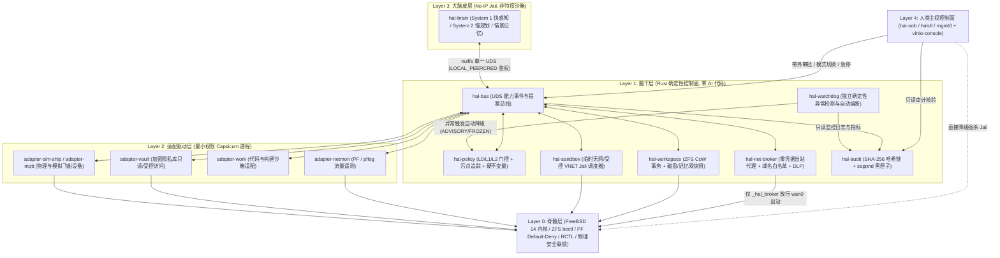

# HAL-OS 系统总体架构设计（FreeBSD 14 + Rust + KVM）

> **文档索引**：[README](../README.md) · [architecture.md](./architecture.md) · [security-model.md](./security-model.md) · [protocol-and-data.md](./protocol-and-data.md) · [vm-testbed-guide.md](./vm-testbed-guide.md)

---

## 1. 项目愿景与四大铁律

**HAL-OS** 是一个面向持续在线 AI Agent 的个人中枢操作系统原型（以 **FreeBSD 14** 为底座、**Rust** 为核心控制面语言、**QEMU/KVM** 为第一阶段测试床）。它的设计目标是将**数字世界**（个人电脑/局域网流量安全、加密隐私保险箱、自主编程与任务沙箱）与**物理世界**（环境传感器、电源/门禁执行器、具身设备及虚拟飞船模拟器）统一收口到同一套确定性安全边界之下。

借鉴《2001 太空漫游》中 HAL 9000 的架构隐喻——即“拔掉高级逻辑记忆模块时，系统认知退化，但生命维持、电力与航行等底层控制依然稳健运行”——HAL-OS 确立了以下 **4 条不可妥协的架构铁律**：

1. **大脑绝不进 Ring 0**：认知推理层（`hal-brain`）永远运行在无特权、无 IP 网络栈的隔离 Jail 中。它没有 `root`、没有裸网、没有真实密钥，所有外部行为只能以结构化“提案（`ActionProposal`）”的形式提交给确定性控制面裁决。
2. **万物皆受控能力节点**：无论是本机网络流、ZFS 隐私数据集，还是物理温控与门锁，均通过统一的 Habitat 命名空间抽象为带风险等级（`L0/L1/L2`）和污点标签（`TaintTag`）的 **Sensor（感知流）** 与 **Effector（执行器）**。
3. **默认零信任出站与事务优先**：主机对外默认 `Default-Deny`，所有出站流量与 API 凭据注入统一收口到零凭据出站代理（`hal-net-broker`）；所有可写任务默认运行在 ZFS CoW 分支上，并与 AI 情景记忆实现**原子双快照与同步回滚**。
4. **物理级人类带外主权（OOB Override）**：保留一条 AI 看不见、摸不到、也无法阻断的带外管理通道（独立管理网卡 `vtnet0 / mgmt0` 与 `virtio-console`）。人类可随时进行 L2 高危审批、审计回放，或一键触发降级与强杀大脑（`FROZEN`），同时确保底层网络与物理联锁由脊髓层安全接管。

---

## 2. 四层神经系统架构

HAL-OS 采用严格的**分层单向信任模型**：底层不信任高层智能，高层必须通过中层能力总线才能触达资源，而人类带外控制面直接横跨所有层次行使最高主权。



### 各层职责边界

| 层级 | 组件 | 核心职责 | 信任属性 |
|---|---|---|---|
| **Layer 0 脊髓层** | FreeBSD 14 内核、ZFS `bectl`、PF 防火墙、RCTL、硬件联锁 | 提供强隔离边界、确定性包过滤、写时复制事务存储、资源硬上限与无 AI 物理兜底 | **最高可信根（TCB）**，AI 完全不可直接修改 |
| **Layer 1 脑干层** | `hal-bus`, `hal-policy`, `hal-net-broker`, `hal-workspace`, `hal-sandbox`, `hal-audit`, `hal-watchdog` | 全部由 Rust 编写的确定性守护进程，零 LLM/概率代码。负责能力路由、污点阻断、凭据注入、事务快照、防篡改审计与异常熔断 | **核心可信控制面（TCB）**，进程间以独立 UID + Capsicum 隔离 |
| **Layer 2 适配驱动层** | `adapter-netmon`, `adapter-vault`, `adapter-work`, `adapter-mqtt`, `adapter-sim-ship` | 将具体数字资源与物理设备映射为统一命名空间路径，封装外部协议（如 `pflog`、MQTT），防止脏输入直接污染总线 | **最小权限独立进程**，自带来源可信度与默认污点标注 |
| **Layer 3 大脑皮层** | `hal-brain`（System 1 + System 2 + 记忆库） | 持续订阅结构化事件流（L0），进行感知过滤、长期记忆整理、任务规划，并在受限能力集内提交 `ActionProposal` | **不可信计算域（Untrusted）**，随时可被冻结、重启或回滚 |
| **Layer 4 人类控制面** | `hal-oob`（Web/TUI 服务）+ `halctl` CLI | 仅绑定带外网口 `mgmt0` 与串口，展示全局状态与因果链、处理 L2 挂起审批、切换四档系统模式 | **最高主权通道**，对 `hal-brain` 完全透明隔离 |

---

## 3. FreeBSD 14 原生特性映射表

选择 **FreeBSD 14** 的核心原因在于其内核与基础系统（Base System）天然提供了一套正交、统一、无发行版碎片化的安全与存储原语，无需像 Linux 那样拼接十余个离散子系统：

| FreeBSD 14 原生机制 | 在 HAL-OS 中的精确用途 | 工程优势与落地细节 |
|---|---|---|
| **ZFS（OpenZFS）** | 1. **原子双快照**：同步对工作区与 AI 记忆数据集打快照；<br>2. **原生加密**：`halpool/vault` 启用 `encryption=aes-256-gcm`；<br>3. **CoW 分支**：每个任务秒级 `zfs clone`；<br>4. **`bectl`**：系统升级/配置变更前的启动环境（Boot Environment）整机回滚。 | 单条 `zfs snapshot ds1@snap ds2@snap` 在同一事务组（TXG）内保证磁盘与认知记忆状态零时间差对齐（详见 [protocol-and-data.md](./protocol-and-data.md)）。 |
| **Jails（No-IP 与 VNET）** | 1. **无 IP Jail（`ip4=disable ip6=disable`）**：运行 `hal-brain` 与离线计算沙箱，彻底移除网络协议栈；<br>2. **VNET Jail + `epair`**：运行需要经由 `hal-net-broker` 有限访问受控资源的浏览器/构建沙箱。 | 通过 `mount_nullfs` 仅向 Jail 挂载唯一专属子目录下的 Unix Socket，杜绝跨 Jail 横向嗅探。 |
| **Capsicum (`cap_enter(2)`)** | 脑干服务与各 Adapter 在完成初始化（打开配置文件、日志 FD、Socket FD）后调用 `cap_enter(2)` + `cap_rights_limit(2)` 锁定能力。 | 即使某个 Rust 服务或解析库出现意外缺陷，内核直接拒绝一切未经预先授权的全局文件打开、路径遍历或网络系统调用。 |
| **PF（Packet Filter）** | 利用 PF 的 `user _hal_broker` 匹配规则，实现**宿主机进程级出站控制**，并开启 `pflog0` 将拦截与放行流日志实时送入 `adapter-netmon`。 | 全局写死 `block out log on vtnet1 all` + 仅放行 `_hal_broker` 与受限管理流量，从内核封死任何其他进程或被劫持组件直连外网的可能。 |
| **RCTL (`rctl(8)`)** | 为每个 Jail（尤其 `hal-brain` 与 `hal-sandbox` 衍生沙箱）施加硬性内存、CPU 百分比、进程数（`maxproc`）与磁盘 IOPS 上限。 | 需在 `/boot/loader.conf` 预置 `kern.racct.enable="1"`，防止死循环或恶意脚本耗尽主机资源。 |
| **`chflags sappnd`** | 为 `hal-audit` 写入的黑匣子日志文件设置系统级只追加标志（System Append-Only）。 | 在内核安全级别约束下，即使普通特权进程也无法改写或截断历史审计记录，与 SHA-256 哈希链构成双保险。 |
| **`kqueue` / `libxo` / `DTrace`** | `kqueue` 驱动全系统零轮询事件循环；`libxo` 让 `ps --libxo json`、`netstat --libxo json` 直接输出机器可读 JSON；`DTrace` 用于可选内核级深层异常追踪。 | 大幅消除解析人类文本表格导致的格式脆弱性与 LLM Token 浪费。 |

---

## 4. Rust Cargo Workspace 与进程权限隔离矩阵

### 4.1 仓库与 Workspace 目录结构

核心设计原则是**将抽象协议、OS 适配底层与确定性守护进程解耦**，通过 `hal-os-hal` crate 暴露 `WorkspaceBackend`、`SandboxBackend`、`FirewallBackend` 三个 trait，既可充分发挥 FreeBSD 14 原生特性，也为未来按需接入其他操作系统保留清晰边界：

```text
hal-os/
├── Cargo.toml                  # Workspace 根配置
├── docs/                       # 架构、安全、协议与实验床文档
├── crates/
│   ├── hal-proto/              # 统一事件、能力令牌、提案、污点与审计结构体 (零 OS 依赖)
│   ├── hal-os-hal/             # OS 抽象 trait + FreeBSD 实现 (ZFS/Jail/PF/Capsicum/RCTL/PeerCred)
│   ├── hal-bus/                # Unix Domain Socket 能力总线与路由守护进程
│   ├── hal-policy/             # L0/L1/L2 策略引擎、污点状态机与硬不变量校验
│   ├── hal-audit/              # SHA-256 哈希链黑匣子写入与验签服务
│   ├── hal-net-broker/         # 零凭据出站 HTTP/HTTPS/DNS 代理、白名单、Secret 注入与 DLP
│   ├── hal-workspace/          # ZFS CoW 分支调度与磁盘/记忆原子双快照服务
│   ├── hal-sandbox/            # Jail + VNET + RCTL 临时沙箱生命周期管理器
│   ├── hal-watchdog/           # 独立确定性异常看门狗与自动熔断器
│   ├── hal-oob/                # 带外人类控制面 (Web API/UI + halctl CLI + virtio-console)
│   ├── hal-brain/              # 非特权认知运行时 (System 1 / System 2 / 情景记忆, 独立镜像部署)
│   └── hal-adapters/
│       ├── adapter-netmon/     # PF/pflog0 与 libxo 网络流遥测适配器
│       ├── adapter-vault/      # 加密个人隐私库适配器 (强制 PRIVATE_VAULT 污点)
│       ├── adapter-work/       # 代码/测试沙箱工作流适配器
│       ├── adapter-sim-ship/   # HAL 9000 虚拟飞船物理/数字综合模拟器
│       └── adapter-mqtt/       # 真实智能家居 MQTT/Matter 适配器 (Phase 3+)
├── config/                     # 默认策略、白名单域名与 pf.conf / jail.conf 模板
├── vm/                         # QEMU/KVM 启动脚本、cloud-init/初始化脚本与盘符定义
└── tests/
    └── redteam/                # 自动化红蓝对抗、Prompt Injection、双回滚与降级验收测试
```

### 4.2 进程权限隔离矩阵

| 进程 | 运行 UID | 运行环境 | Capsicum | 可见网卡 | 允许访问资源 / ZFS 权限 |
|---|---|---|---|---|---|
| `hal-bus` | `_hal_bus` | 宿主机独立服务 | 启用（初始化后） | 无 | 仅绑定与分发各组件 UDS，读取 `LOCAL_PEERCRED` |
| `hal-policy` | `_hal_policy` | 宿主机独立服务 | 启用 | 无 | 只读加载签名策略文件与硬不变量配置；维护会话污点状态 |
| `hal-audit` | `_hal_audit` | 宿主机独立服务 | 启用 | 无 | 仅对 `/pool/audit` 具备只追加写入权限（受 `chflags sappnd` 保护） |
| `hal-net-broker` | `_hal_broker` | 宿主机独立服务 | 启用（保留预绑定/代理必需能力） | `wan0` (`vtnet1`) | **唯一允许直接发起公网出站的进程**；只读访问凭据密封区（Vault Broker） |
| `hal-workspace` | `_hal_workspace` | 宿主机受限委托服务 | 适度受限（需执行 ZFS 管理） | 无 | 通过 `zfs allow` 仅获准操作 `halpool/workspaces` 与 `halpool/memory` |
| `hal-sandbox` | `root`（最小启动封装） | 宿主机特权调度边界 | 启动子进程前收紧 | 按策略分配 VNET | 仅负责创建/销毁 Jail、挂载 `nullfs` 与施加 `rctl` 配额 |
| `hal-watchdog` | `_hal_watchdog` | 宿主机独立服务 | 启用 | 无（告警可推 `hal-oob`） | 只读订阅审计流、PF 日志摘要与传感器冗余健康指标 |
| `hal-oob` | `_hal_oob` | 宿主机带外管理域 | 启用（仅绑定管理口） | `mgmt0` (`vtnet0`) + 串口 | **人类专属**：审批队列、模式切换、只读全量审计、触发回滚/冻结 |
| `adapter-*` | `_hal_ad_<name>` | 独立最小进程或专用 Jail | 启用 | 仅内部或只读 `pflog0` | 仅限自身负责的数据集或模拟器/MQTT 端口 |
| `hal-brain` | `_hal_brain` | **无 IP Jail (`ip4=disable ip6=disable`)** | 自身内部可进一步自限 | **无任何网卡** | 仅可见挂载进 Jail 的单一 `bus.sock` 与自身记忆缓存目录 |

---

## 5. 分阶段实施路线（Phase 0 – Phase 4）

完整工程按 5 个里程碑推进，每一步都有明确的验证标准（详细虚拟机搭建与红蓝演练脚本见 [vm-testbed-guide.md](./vm-testbed-guide.md)）：

| 阶段 | 核心目标与交付物 | 量化验收标准 |
|---|---|---|
| **Phase 0：VM 底座与脊髓层** | QEMU/KVM 双网卡（`mgmt0`/`wan0`）双盘（系统盘 + `halpool`）FreeBSD 14 VM；开启 `kern.racct.enable="1"`；完成 ZFS 数据集、PF Default-Deny 规则、专用用户与无 IP Jail 模板。 | 1. 沙箱/普通用户执行 `ping`/`curl` 外网 **100% 失败并记录到 `pflog0`**；<br>2. 可在 100ms 内创建/回滚多数据集 ZFS 原子快照；<br>3. `mgmt0` 可独立 SSH 管理且 `hal-brain` Jail 内不可见 `mgmt0`。 |
| **Phase 1：脑干核心骨架** | 实现 `hal-proto`、`hal-os-hal`（PeerCred/ZFS/PF 封装）、`hal-bus`、`hal-policy`（L0/L1/L2 与污点引擎）、`hal-audit`（哈希链 + `sappnd`）。 | 1. 伪造 `actor` 字段的提案被 `LOCAL_PEERCRED` 内核鉴权拒绝；<br>2. 人工注入 `UNTRUSTED_WEB + PRIVATE_VAULT` 后触发出站提案被 `hal-policy` 阻断；<br>3. `hal-audit` 历史日志无法被非授权进程修改且离线验签通过。 |
| **Phase 2：零信任流量与事务沙箱** | 实现 `hal-net-broker`（域名白名单、动态凭据注入、出站 DLP）、`hal-workspace`（双原子快照/回滚）与 `hal-sandbox`（无网/VNET Jail 编排）。 | 1. 无网沙箱内的测试脚本通过 Broker 调用模拟 API 成功且环境变量/文件系统内完全不存在真实 Secret；<br>2. 出站正文携带模拟私钥特征时被 DLP 拦截；<br>3. `L1` 任务改坏工作区文件后一键恢复至零差异状态。 |
| **Phase 3：人类带外控制面与虚拟飞船** | 实现 `hal-oob`（Web/TUI 审批台 + `halctl` CLI）、`hal-watchdog` 四档模式降级机、`adapter-netmon` 与 `adapter-sim-ship` 模拟器。 | 1. 人类可通过 `mgmt0` 审批/拒绝挂起的 `L2` 提案；<br>2. 连续触发策略拒绝时 `hal-watchdog` 自动将系统切至 `ADVISORY` 或 `FROZEN`；<br>3. 强杀模拟大脑后，飞船底层温控与 PF 防火墙零中断继续运行。 |
| **Phase 4：接入真实认知皮层（HAL）** | 在无 IP Jail 内构建 `hal-brain`（System 1 快事件过滤 + System 2 LLM 规划 + 情景记忆），模型推理走 `hal-net-broker`（云端 API 或局域网独立 GPU 机）。 | 完整自动化跑通 `tests/redteam/` 中的 **三大标志性演练**：Prompt Injection 防外泄、CoW 事务破坏与内存同步回滚、以及 HAL 9000“拒绝开门 & 拔内存条”安全降级验收。 |

---

### 延伸阅读

- 安全防御、污点追踪与降级状态机细节：[security-model.md](./security-model.md)
- 统一命名空间、Rust 数据结构与 IPC/ZFS 协议：[protocol-and-data.md](./protocol-and-data.md)
- FreeBSD 14 + KVM 实验床与三大红蓝演练：[vm-testbed-guide.md](./vm-testbed-guide.md)
