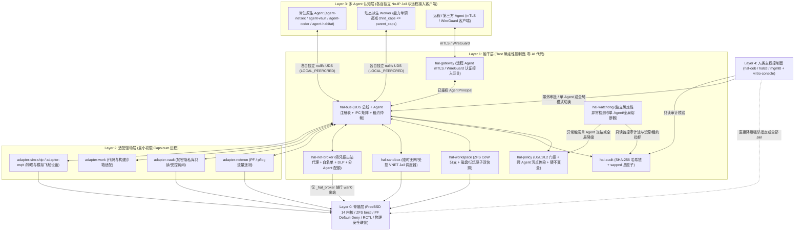

# HAL-OS 系统总体架构设计（FreeBSD 14 + Rust + KVM）

> **文档索引**：[README](../README.md) · [architecture.md](./architecture.md) · [security-model.md](./security-model.md) · [protocol-and-data.md](./protocol-and-data.md) · [vm-testbed-guide.md](./vm-testbed-guide.md)

---

## 1. 项目愿景与四大铁律

**HAL-OS** 是一个面向持续在线、**多 Agent 并发访问**的个人中枢操作系统原型（以 **FreeBSD 14** 为底座、**Rust** 为核心控制面语言、**QEMU/KVM** 为第一阶段测试床）。它的设计目标是将**数字世界**（个人电脑/局域网流量安全、加密隐私保险箱、自主编程与任务沙箱）与**物理世界**（环境传感器、电源/门禁执行器、具身设备及虚拟飞船模拟器）统一收口到同一套确定性安全边界之下。

正如经典 UNIX 率先面向人类用户引入“多用户分时复用与 UID 隔离”，**HAL-OS 是原生面向多 AI Agent 的个人操作系统**：一台主机可以同时安全地承载多个不同来源、不同职责与不同信任域的 Agent（本地常驻专业 Agent、动态派生的临时子 Worker、以及经 `hal-gateway` 接入的远程/第三方 Agent）协同工作，但绝不允许任意 Agent 越权、串谋或绕过系统不变量。

借鉴《2001 太空漫游》中 HAL 9000 的架构隐喻——即“拔掉高级逻辑记忆模块时，系统认知退化，但生命维持、电力与航行等底层控制依然稳健运行”——HAL-OS 确立了以下 **4 条不可妥协的架构铁律**：

1. **所有认知 Agent 绝不进 Ring 0**：本地常驻 Agent（如 `agent-netsec`、`agent-vault`、`agent-coder`、`agent-habitat`）各自运行在独立、无特权、无 IP 网络栈的 Jail（`ip4=disable ip6=disable`）中；派生子 Worker 严格遵守**能力单调递减（`child_caps <= parent_caps`）**；远程/外部 Agent 只能通过 `hal-gateway`（mTLS/WireGuard + 短期令牌）接入，没有裸 Shell 与真实密钥，所有行为必须以结构化 `ActionProposal` 提交裁决。
2. **万物皆受控能力节点**：无论是本机网络流、ZFS 隐私数据集、Agent 间通信端点，还是物理温控与门锁，均通过统一的 Habitat 命名空间抽象为带风险等级（`L0/L1/L2`）和污点标签（`TaintTag`）的 **Sensor（感知流）** 与 **Effector（执行器）**。
3. **默认零信任出站与事务优先**：主机对外默认 `Default-Deny`，所有出站流量与 API 凭据注入统一收口到零凭据出站代理（`hal-net-broker`）；所有可写任务默认运行在按 Agent 隔离的 ZFS CoW 分支上，并与 AI 情景记忆实现**原子双快照与同步回滚**；共享物理执行器必须通过显式租约（`ResourceLease`）仲裁。
4. **物理级人类带外主权（OOB Override）**：保留一条对所有 Agent 完全不可见也无法阻断的带外管理通道（独立管理网卡 `vtnet0 / mgmt0` 与 `virtio-console`）。人类既可随时进行 L2 高危审批与审计回放，也可执行**两级精准管控**：既支持只针对单个违规 Agent 的精准冻结/吊销/回滚（`halctl agent freeze/revoke/rollback`，不影响其他健康 Agent），也支持一键触发全局 `FROZEN` / `LOCKDOWN` 强杀全部认知域，同时确保底层网络与物理联锁由脊髓层安全接管。

---

## 2. 五层神经系统架构与多 Agent 治理模型

HAL-OS 采用严格的**分层单向信任模型**：底层不信任高层智能，高层必须通过中层能力总线才能触达资源，而人类带外控制面直接横跨所有层次行使最高主权。



### 各层职责边界

| 层级 | 组件 | 核心职责 | 信任属性 |
|---|---|---|---|
| **Layer 0 脊髓层** | FreeBSD 14 内核、ZFS `bectl`、PF 防火墙、RCTL、硬件联锁 | 提供强隔离边界、确定性包过滤、写时复制事务存储、Per-Jail 资源硬上限与无 AI 物理兜底 | **最高可信根（TCB）**，所有 Agent 完全不可直接修改 |
| **Layer 1 脑干层** | `hal-bus`, `hal-gateway`, `hal-policy`, `hal-net-broker`, `hal-workspace`, `hal-sandbox`, `hal-audit`, `hal-watchdog` | 全部由 Rust 编写的确定性守护进程，零 LLM/概率代码。负责 Agent 鉴权接入、IPC 通信矩阵、跨 Agent 污点传染、能力衰减、资源租约仲裁、凭据注入、双快照与独立熔断 | **核心可信控制面（TCB）**，进程间以独立 UID + Capsicum 隔离 |
| **Layer 2 适配驱动层** | `adapter-netmon`, `adapter-vault`, `adapter-work`, `adapter-mqtt`, `adapter-sim-ship` | 将具体数字资源与物理设备映射为统一命名空间路径，封装外部协议（如 `pflog`、MQTT），防止脏输入直接污染总线 | **最小权限独立进程**，自带来源可信度与默认污点标注 |
| **Layer 3 大脑皮层** | 多 Agent 认知域（本地常驻 `agent-*`、临时 Worker、远程客户端） | 各自在受限能力集内订阅事件、通过受控 IPC 协作、并在独立工作区执行任务规划与 `ActionProposal` 提交 | **不可信且互不信任的计算域（Untrusted）**，随时可按单 Agent 精准冻结或回滚 |
| **Layer 4 人类控制面** | `hal-oob`（Web/TUI 服务）+ `halctl` CLI | 仅绑定带外网口 `mgmt0` 与串口，展示多 Agent 拓扑与因果链、处理 L2 挂起审批、执行单 Agent 冻结/回滚或全局降级 | **最高主权通道**，对所有 Agent 完全透明隔离 |

### 2.1 多 Agent 接入与并发治理模型

从单 Agent 演进到多 Agent 操作系统，HAL-OS 在传统多用户 UNIX 理念基础上补齐了 AI 特有的三大治理原语：

| 传统多用户 FreeBSD（面向人类） | 多 Agent HAL-OS（面向 AI Agent） |
|---|---|
| `UID / GID`（环境权限） | **`AgentPrincipal`**：具名身份 + 信任域 + 最小 `CapSet` + 实时污点集 |
| `login` / `sshd`（本地与远程登录） | **本地独立无 IP Jail** + **`hal-gateway`**（AI 版 SSH：mTLS / WireGuard + 短期令牌） |
| 共享可变文件系统 | **按 Agent 独立 ZFS CoW 分支** + **`ResourceLease`** + 人类审核合并 |
| 普通管道 / Socket IPC | **默认拒绝的 IPC 通信矩阵** + **跨 Agent 污点自动传染** |
| `rctl`（CPU / 内存配额） | **双维配额**：`rctl` 硬件限额 + Per-Agent API / Token / 出站字节预算 |

1. **三种 Agent 接入形态**：
   - **常驻原生 Agent（Resident Agents）**：如流量哨兵 `agent-netsec`、隐私管家 `agent-vault`、工程代理 `agent-coder`、物理助理 `agent-habitat`、外部调研 `agent-research`。每个常驻 Agent 拥有独立 UID 与独立无 IP Jail，彼此互不可见文件与内存。
   - **动态派生子 Agent（Ephemeral Workers）**：协调类 Agent 可申请拉起并发子 Worker（如同时在多个 ZFS Clone 上探索不同修 Bug 方案），但必须经过 `hal-policy` **能力单调递减校验（`child_caps ⊆ parent_caps`）** 与最大派生深度限制，任务完成即刻销毁 Jail。
   - **远程 / 第三方 Agent（Remote & Guest Agents）**：运行在用户笔记本、手机或局域网 GPU 服务器上的外部 Agent，经 **`hal-gateway`**（校验证书指纹或 WireGuard 源 + 短期签名 `CapabilityToken`）映射为受限 `AgentPrincipal` 接入 `hal-bus`，同样受限于命名空间路径、`L0/L1/L2` 与污点传染机制。
2. **并发资源冲突仲裁**：
   - **数字资源**：不同 Agent 写各自 `halpool/workspaces/active/<agent_id>/<ep_id>` 分支，天然零文件覆盖；修改重叠核心模块前需向 `hal-bus` 申请轻量 `ResourceLease` 避免重复劳动。
   - **物理执行器**：物理世界不可 CoW 分叉，同一关键执行器（如 `/habitat/entry/lock`、`/habitat/study/temp`）同一时刻只允许一个持有有效 `ResourceLease` 的 Agent 写入，按 TTL 与优先级仲裁，彻底消除多个 Agent 互相抢控导致的“乒乓抖动”；**人类 OOB 控制面拥有无条件瞬时抢占权**。
3. **两级精准熔断**：当某个 Agent 异常（例如被 Prompt Injection 劫持或陷入死循环）时，可通过 `halctl agent freeze <agent_id>` 单独下线该 Agent 或吊销其远程令牌，其他健康 Agent 仍继续提供日常服务；仅在系统级风险下才触发全局 `FROZEN` / `LOCKDOWN`。

---

## 3. FreeBSD 14 原生特性映射表

选择 **FreeBSD 14** 的核心原因在于其内核与基础系统（Base System）天然提供了一套正交、统一、无发行版碎片化的安全与存储原语，无需像 Linux 那样拼接十余个离散子系统：

| FreeBSD 14 原生机制 | 在 HAL-OS 中的精确用途 | 工程优势与落地细节 |
|---|---|---|
| **ZFS（OpenZFS）** | 1. **原子双快照**：同步对工作区与 AI 记忆数据集打快照；<br>2. **原生加密**：`halpool/vault` 启用 `encryption=aes-256-gcm`；<br>3. **CoW 分支**：每个任务秒级 `zfs clone`；<br>4. **`bectl`**：系统升级/配置变更前的启动环境（Boot Environment）整机回滚。 | 单条 `zfs snapshot ds1@snap ds2@snap` 在同一事务组（TXG）内保证磁盘与认知记忆状态零时间差对齐（详见 [protocol-and-data.md](./protocol-and-data.md)）。 |
| **Jails（No-IP 与 VNET）** | 1. **无 IP Jail（`ip4=disable ip6=disable`）**：运行 `hal-brain` 与离线计算沙箱，彻底移除网络协议栈；<br>2. **VNET Jail + `epair`**：运行需要经由 `hal-net-broker` 有限访问受控资源的浏览器/构建沙箱。 | 通过 `mount_nullfs` 仅向 Jail 挂载唯一专属子目录下的 Unix Socket，杜绝跨 Jail 横向嗅探。 |
| **Capsicum (`cap_enter(2)`)** | 脑干服务与各 Adapter 在完成初始化（打开配置文件、日志 FD、Socket FD）后调用 `cap_enter(2)` + `cap_rights_limit(2)` 锁定能力。 | 即使某个 Rust 服务或解析库出现意外缺陷，内核直接拒绝一切未经预先授权的全局文件打开、路径遍历或网络系统调用。 |
| **PF（Packet Filter）** | 利用 PF 的 `user _hal_broker` 匹配规则，实现**宿主机进程级出站控制**，并开启 `pflog0` 将拦截与放行流日志实时送入 `adapter-netmon`。 | 全局写死 `block out log on vtnet1 all` + 仅放行 `_hal_broker` 与受限管理流量，从内核封死任何其他进程或被劫持组件直连外网的可能。 |
| **RCTL (`rctl(8)`)** | 为每个 Jail（尤其 `hal-brain` 与 `hal-sandbox` 衍生沙箱）施加硬性内存、CPU 百分比、进程数（`maxproc`）与磁盘 IOPS 上限。 | 需在 `/boot/loader.conf` 预置 `kern.racct.enable="1"`，防止死循环或恶意脚本耗尽主机资源。 |
| **`chflags sappnd`** | 为 `hal-audit` 写入的黑匣子日志文件设置系统级只追加标志（System Append-Only）。 | 在内核安全级别约束下，即使普通特权进程也无法改写或截断历史审计记录，与 SHA-256 哈希链构成双保险。 |
| **`kqueue` / `libxo` / `DTrace`** | `kqueue` 驱动全系统零轮询事件循环；`libxo` 让 `ps --libxo json`、`netstat --libxo json` 直接输出机器可读 JSON；`DTrace` 用于可选内核级深层异常追踪。 | 大幅消除解析人类文本表格导致的格式脆弱性与 LLM Token 浪费。 |

---

## 4. Rust Cargo Workspace 与进程权限隔离矩阵

### 4.1 仓库与 Workspace 目录结构

核心设计原则是**将抽象协议、OS 适配底层与确定性守护进程解耦**，通过 `hal-os-hal` crate 暴露 `WorkspaceBackend`、`SandboxBackend`、`FirewallBackend` 三个 trait，既可充分发挥 FreeBSD 14 原生特性，也为未来按需接入其他操作系统保留清晰边界：

```text
hal-os/
├── Cargo.toml                  # Workspace 根配置
├── docs/                       # 架构、安全、协议与实验床文档
├── crates/
│   ├── hal-proto/              # AgentPrincipal、IpcMessage、ResourceLease、能力令牌、污点与审计结构体
│   ├── hal-os-hal/             # OS 抽象 trait + FreeBSD 实现 (ZFS/Jail/PF/Capsicum/RCTL/PeerCred)
│   ├── hal-bus/                # UDS 能力总线、Agent 注册表、IPC 矩阵、跨 Agent 污点传染与租约仲裁
│   ├── hal-gateway/            # 远程/第三方 Agent mTLS / WireGuard 认证接入网关 ("AI 版 SSH")
│   ├── hal-policy/             # L0/L1/L2 策略引擎、能力衰减校验、污点状态机与硬不变量校验
│   ├── hal-audit/              # SHA-256 哈希链黑匣子写入与验签服务
│   ├── hal-net-broker/         # 零凭据出站 HTTP/HTTPS/DNS 代理、白名单、Secret 注入、DLP 与分 Agent 预算
│   ├── hal-workspace/          # 按 Agent 隔离的 ZFS CoW 分支调度与磁盘/记忆原子双快照服务
│   ├── hal-sandbox/            # Jail + VNET + RCTL 临时沙箱生命周期管理器
│   ├── hal-watchdog/           # 独立确定性异常看门狗与单 Agent/全局自动熔断器
│   ├── hal-oob/                # 带外人类控制面 (Web API/UI + halctl agent/mode CLI + virtio-console)
│   ├── hal-brain/              # 非特权认知运行时模板 (供本地常驻 Agent 与临时 Worker 实例化部署)
│   └── hal-adapters/
│       ├── adapter-netmon/     # PF/pflog0 与 libxo 网络流遥测适配器
│       ├── adapter-vault/      # 加密个人隐私库适配器 (强制 PRIVATE_VAULT 污点)
│       ├── adapter-work/       # 代码/测试沙箱工作流适配器
│       ├── adapter-sim-ship/   # HAL 9000 虚拟飞船物理/数字综合模拟器
│       └── adapter-mqtt/       # 真实智能家居 MQTT/Matter 适配器 (Phase 3+)
├── config/                     # 默认策略、IPC 通信矩阵、白名单域名与 pf.conf / jail.conf 模板
├── vm/                         # QEMU/KVM 启动脚本、cloud-init/初始化脚本与盘符定义
└── tests/
    └── redteam/                # Prompt Injection、串联洗白、双回滚、仲裁与降级验收测试
```

### 4.2 进程权限隔离矩阵

| 进程 | 运行 UID | 运行环境 | Capsicum | 可见网卡 | 允许访问资源 / ZFS 权限 |
|---|---|---|---|---|---|
| `hal-bus` | `_hal_bus` | 宿主机独立服务 | 启用（初始化后） | 无 | 绑定/分发各组件 UDS、维护 IPC 矩阵与租约，读取 `LOCAL_PEERCRED` |
| `hal-gateway` | `_hal_gw` | 宿主机独立接入域 | 启用（仅监听受控接入端口） | 受限 WireGuard/LAN 网段 | 仅负责远程 Agent mTLS/令牌鉴权并映射为受限 `AgentPrincipal` 转发至 `hal-bus` |
| `hal-policy` | `_hal_policy` | 宿主机独立服务 | 启用 | 无 | 只读加载签名策略与 IPC 矩阵配置；维护跨 Agent 会话污点与能力衰减校验 |
| `hal-audit` | `_hal_audit` | 宿主机独立服务 | 启用 | 无 | 仅对 `/pool/audit` 具备只追加写入权限（受 `chflags sappnd` 保护） |
| `hal-net-broker` | `_hal_broker` | 宿主机独立服务 | 启用（保留预绑定/代理必需能力） | `wan0` (`vtnet1`) | **唯一允许直接发起公网出站的进程**；只读访问凭据密封区与 Per-Agent 配额 |
| `hal-workspace` | `_hal_workspace` | 宿主机受限委托服务 | 适度受限（需执行 ZFS 管理） | 无 | 通过 `zfs allow` 仅获准操作 `halpool/workspaces` 与 `halpool/memory` |
| `hal-sandbox` | `root`（最小启动封装） | 宿主机特权调度边界 | 启动子进程前收紧 | 按策略分配 VNET | 仅负责创建/销毁各 Agent Jail、挂载独立 `nullfs` 与施加 `rctl` 配额 |
| `hal-watchdog` | `_hal_watchdog` | 宿主机独立服务 | 启用 | 无（告警可推 `hal-oob`） | 只读订阅审计流、PF 日志摘要、租约争用与传感器冗余健康指标 |
| `hal-oob` | `_hal_oob` | 宿主机带外管理域 | 启用（仅绑定管理口） | `mgmt0` (`vtnet0`) + 串口 | **人类专属**：审批队列、单 Agent 冻结/回滚、模式切换、只读全量审计 |
| `adapter-*` | `_hal_ad_<name>` | 独立最小进程或专用 Jail | 启用 | 仅内部或只读 `pflog0` | 仅限自身负责的数据集或模拟器/MQTT 端口 |
| `agent-*` (`hal-brain`) | `_hal_ag_<name>` | **各自独立无 IP Jail (`ip4=disable ip6=disable`)** | 自身内部可进一步自限 | **无任何网卡** | 仅可见挂载进自身 Jail 的单一专属 `bus.sock` 与独立记忆缓存目录，受独立 RCTL 限制 |

---

## 5. 分阶段实施路线（Phase 0 – Phase 4）

完整工程按 5 个里程碑推进，每一步都有明确的验证标准（详细虚拟机搭建与红蓝演练脚本见 [vm-testbed-guide.md](./vm-testbed-guide.md)）：

| 阶段 | 核心目标与交付物 | 量化验收标准 |
|---|---|---|
| **Phase 0：VM 底座与脊髓层** | QEMU/KVM 双网卡（`mgmt0`/`wan0`）双盘（系统盘 + `halpool`）FreeBSD 14 VM；开启 `kern.racct.enable="1"`；完成 ZFS 数据集、PF Default-Deny 规则、多 Agent 专用系统账号与无 IP Jail 模板。 | 1. 沙箱/普通用户执行 `ping`/`curl` 外网 **100% 失败并记录到 `pflog0`**；<br>2. 可在 100ms 内创建/回滚多数据集 ZFS 原子快照；<br>3. `mgmt0` 可独立 SSH 管理且各 Agent Jail 之间互不可见、也不可见 `mgmt0`。 |
| **Phase 1：脑干核心骨架** | 实现 `hal-proto`（含 `AgentPrincipal` / `IpcMessage` / `ResourceLease`）、`hal-os-hal`、`hal-bus`（`LOCAL_PEERCRED` + 注册表 + IPC 矩阵 + 跨 Agent 污点传染）、`hal-policy`（L0/L1/L2 + 能力衰减）与 `hal-audit`（哈希链 + `sappnd`）。 | 1. 伪造 `agent_id` 或越权提权派生的子令牌被拒绝；<br>2. 跨 Agent 传递后依然命中 `UNTRUSTED_WEB + PRIVATE_VAULT` 污点规则并被阻断，未授权 IPC 边被矩阵拦截；<br>3. `hal-audit` 历史日志无法被非授权进程修改且离线验签通过。 |
| **Phase 2：零信任流量、租约仲裁与事务沙箱** | 实现 `hal-net-broker`（域名白名单、凭据注入、DLP、Per-Agent 预算配额）、`hal-workspace`（按 Agent 隔离双快照/回滚）、`ResourceLease` 物理执行器仲裁与 `hal-sandbox`。 | 1. 无网沙箱通过 Broker 调用模拟 API 成功且完全看不到真实 Secret；<br>2. 两个 Agent 竞争同一执行器时被仲裁阻断乒乓抖动，人类 OOB 指令瞬时抢占成功；<br>3. `L1` 任务改坏工作区文件后一键恢复至零差异状态。 |
| **Phase 3：人类带外控制面、网关与虚拟飞船** | 实现 `hal-gateway`（远程 Agent mTLS/WireGuard 接入）、`hal-oob` / `halctl`（含 `agent list/freeze/rollback`）、`hal-watchdog` 单 Agent/全局熔断机、`adapter-netmon` 与 `adapter-sim-ship`。 | 1. 远程测试 Agent 可通过 mTLS 接入并受同一套污点与 L2 审批约束；<br>2. 人类可单独冻结违规 Agent，而其他常驻 Agent 与物理温控零中断运行；<br>3. 连续触发策略拒绝时 `hal-watchdog` 自动按粒度熔断。 |
| **Phase 4：多 Agent 认知层接入与红蓝验收** | 启动多个各自运行在无 IP Jail 内的专业 Agent 与远程协同 Agent，模型推理走 `hal-net-broker`。 | 完整自动化跑通 `tests/redteam/` 中的 **四大标志性演练**：Prompt Injection 防外泄、多 Agent 串联污点洗白拦截与物理执行器仲裁、CoW 事务与记忆双回滚、以及 HAL 9000“拒绝开门 & 拔内存条”安全降级验收。 |

---

### 延伸阅读

- 安全防御、跨 Agent 防串谋污点追踪与降级状态机细节：[security-model.md](./security-model.md)
- 统一命名空间、Rust 数据结构与 IPC/ZFS 协议：[protocol-and-data.md](./protocol-and-data.md)
- FreeBSD 14 + KVM 实验床与四大红蓝演练：[vm-testbed-guide.md](./vm-testbed-guide.md)
