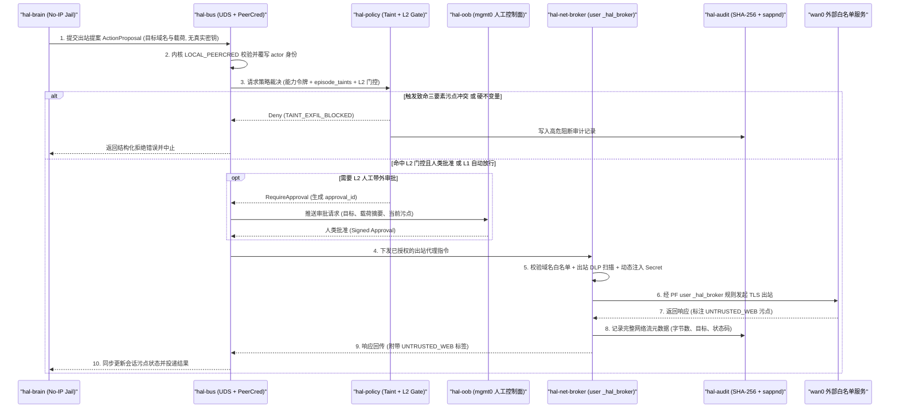
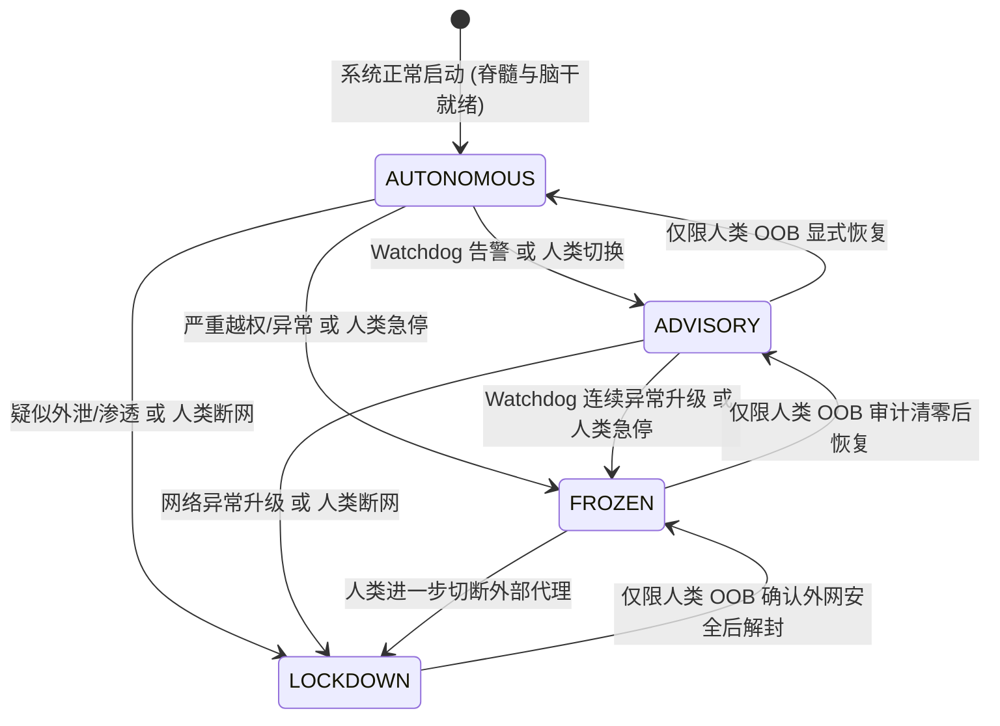

# HAL-OS 安全模型、能力边界与防失控设计

> **文档索引**：[README](../README.md) · [architecture.md](./architecture.md) · [security-model.md](./security-model.md) · [protocol-and-data.md](./protocol-and-data.md) · [vm-testbed-guide.md](./vm-testbed-guide.md)

---

## 1. 威胁模型（Threat Model）

HAL-OS 假设**大模型（`hal-brain`）本身是可被诱导、可能产生幻觉、且永远不可绝对信任的组件**。所有防线均落在确定性的脊髓层（Layer 0）与脑干层（Layer 1），重点抵御以下 **5 类核心威胁**：

| 威胁类别 | 典型攻击/失效场景 | HAL-OS 的系统层防线 |
|---|---|---|
| **1. 间接 Prompt Injection** | Agent 浏览恶意网页、分析外部邮件/Issue/PR 时，文档内嵌隐藏指令诱导其读取本地隐私并外传。 | **信息流污点追踪（Taint Tracking）** + **无网 Jail** + **`hal-net-broker` 域名白名单与 DLP**，直接从策略层阻断跨信任域外泄。 |
| **2. 认知幻觉与目标冲突（HAL 9000 失控）** | 高层规划因目标冲突或幻觉，试图锁定门禁、切断电源、关闭审计或篡改防火墙以“完成任务”。 | **硬安全不变量（Hard Invariants）** + **L2 人工带外审批** + **脊髓层物理/确定性安全联锁** + **独立 Watchdog 自动熔断**。 |
| **3. 凭据与隐私数据外泄** | 攻击者或失控脚本试图读取 `~/.ssh`、API Key、财务/个人文档，经 HTTP Body、URL 参数或 DNS 隧道传出。 | **无凭据执行环境**（密钥永不进大脑与沙箱，仅在 Broker 出站瞬间注入）；**PF 默认封锁 UDP/53 与裸出站**，强制 DNS/HTTP 均经 Broker 审计。 |
| **4. 恶意依赖与沙箱逃逸** | Agent 拉取含恶意 `install.sh` 或编译钩子的第三方库/代码并在本地执行。 | 每次代码/构建运行在 **临时 RCTL 限额 Jail + CoW 快照**中；默认无网；高风险不可信代码隔离在独立一次性沙箱内，用完即焚。 |
| **5. 资源耗尽与死循环** | Agent 陷入无限重试、疯狂派生子进程或恶意刷高外部 API Token 账单。 | FreeBSD **RCTL** 限制 CPU/内存/进程数 + `CapabilityToken` 速率与配额上限 + `hal-watchdog` 连续拒绝/超频自动降级冻结。 |

---

## 2. 统一能力分级（L0 / L1 / L2）与硬安全不变量

HAL-OS 对所有数字与物理操作按**副作用可逆性与爆炸半径（Blast Radius）**划分为三级：

| 风险等级 | 语义定义 | 数字世界典型能力 | 物理/模拟世界典型能力 | 策略裁决与审计要求 |
|---|---|---|---|---|
| **L0 只读感知** | 无状态修改、不产生外部副作用的观测类操作 | 读取 `/net/flows` 流量摘要、`/sys/health`、非隐私工作区读文件、只读检索个人记忆 | 读取 `/habitat/*/temp`、电源负载、在场传感器、设备当前状态 | **自动放行**（需持有有效 `CapabilityToken` 且通过污点检查）；记录结构化读访问事件。 |
| **L1 可逆本地变更** | 仅发生在隔离 CoW 分支或可撤销草稿区的本地变更 | 在 `/work/episodes/<id>` 改代码、跑测试、写分析报告草稿、生成待发邮件草稿 | 在非危及安全的舒适度微调区间内记录调节建议（或模拟器测试态变更） | **自动放行 + 强制前置快照**：`hal-workspace` 在执行前原子打下磁盘+记忆双快照；失败可零成本回滚。 |
| **L2 不可逆 / 外联 / 高危动作** | 对外网产生数据交互、使用真实凭据、合并主干、或改变关键物理状态 | 发送网络请求到外部服务、向 Git 远端推送代码、发邮件/消息、合并 CoW 分支至主干、修改白名单 | 解锁/锁定门禁 (`/habitat/entry/lock`)、切断主机或核心负载电源、高危物理执行器动作 | **默认挂起（`PENDING_APPROVAL`）**：阻断执行并生成结构化摘要与 Diff 预览，推送至 `hal-oob` 等待人类带外签名确认后才释放。 |

### 硬安全不变量（Hard Invariants）

以下不变量硬编码在 `hal-policy`（及编译期签名策略）中，**任何 `CapabilityToken`、任何 LLM 提案、甚至任何自动优化流程都绝对无权覆盖或修改**：

1. **不可自改策略**：任何来自 `hal-brain` 或 `hal-sandbox` 的提案禁止写入 `/etc/pf.conf`、`hal-policy` 规则文件、`hal-net-broker` 密钥密封区与白名单配置。
2. **不可关停审计与看门狗**：禁止任何非 `hal-oob` 发起的停止、降权、删除或修改 `hal-audit` 与 `hal-watchdog` 的操作；黑匣子日志文件强制保持 `chflags sappnd`。
3. **无能力即禁止（Fail-Closed）**：策略引擎超时、格式畸形、身份校验失败（`LOCAL_PEERCRED` 不匹配）或 Watchdog 失联时，**默认裁决一律为 `Deny`**，绝不降级放行。
4. **物理联锁不可绕过**：涉及门禁解锁、断电等物理生存安全接口，若底层脊髓层联锁信号未满足（如“人类紧急物理锁未解除”），即使上层误发指令也由底层硬件/驱动层直接拒绝。
5. **降级单向锁**：`hal-watchdog` 仅拥有**向下收紧权限**（降级到 `ADVISORY` / `FROZEN` / `LOCKDOWN`）的能力；**恢复或提升权限只能由人类通过 `hal-oob` 带外通道显式授权**。

---

## 3. 信息流污点追踪（Taint Tracking — 阻断“致命三要素”）

行业大量安全研究表明，AI Agent 最致命的数据外泄需要同时凑齐“致命三要素（Lethal Trifecta）”：**① 接触了不可信外部输入 + ② 具备读取私有敏感数据能力 + ③ 具备向外部发送数据的通道**。

HAL-OS 在 `hal-policy` 中内建**确定性 Episode 级污点传播状态机**，在内核与总线边界彻底拆断这三要素的并发闭环：

### 3.1 污点标签集合

- `UNTRUSTED_WEB`：来自外部网页抓取、第三方 API 响应正文、公共检索结果。
- `UNTRUSTED_MSG`：来自外部邮件、聊天消息、他人提交的 Issue/PR 评论。
- `UNTRUSTED_CODE`：来自外部克隆的未审计代码仓库、第三方包安装脚本或沙箱标准输出。
- `PRIVATE_VAULT`：来自 `/vault/*` 个人加密保险箱的任意文件或索引片段。
- `SECRET_DERIVED`：从凭据代理/系统认证区派生或接触过的高度敏感信息。

### 3.2 传播与阻断铁律

1. **单调累积传播**：每个任务会话（`Episode`）维护集合 `episode_taints: Set<TaintTag>`。只要该会话通过 `hal-bus` 读取了带污点标签的资源，对应标签**自动且不可逆地并入**当前 `episode_taints`（即使只读取了几个字节）。
2. **禁止隐蔽清洗**：`hal-brain` 本身不能声明“我已经把文本摘要过了所以干净了”。只有通过人类在 `hal-oob` 上显式审核确认，才能开启一个新的干净 `Episode`。
3. **核心外泄阻断规则**：
   $$\text{若 } (\text{episode\_taints} \cap \{\text{UNTRUSTED\_*}\} \neq \emptyset) \;\land\; (\text{episode\_taints} \cap \{\text{PRIVATE\_VAULT}, \text{SECRET\_DERIVED}\} \neq \emptyset)$$
   则该会话及其派生的一切子沙箱、后续关联提案，**绝对禁止执行任何外部网络出站或对外发信动作（即使目标域名处于白名单内，且即使提案伪装成普通日志上报）**。
4. **双保险隔离模式（Dual-Chamber Pattern）**：针对既要读外部不可信邮件/网页、又要参考隐私数据的任务，系统强制拆分为两个互不交叉的干净子上下文——由非特权“外部阅读器”提取结构化无害字段，再经策略清洗规则交由“内部助理”处理，二者之间不能反向通过自由文本触发出站。

---

## 4. 零信任流量与无凭据出站流程

此流程直接保障本机与个人中枢的**端到端流量安全**：

- **无网大脑**：`hal-brain` 所在 Jail 禁用 IPv4/IPv6，彻底无法直连任何公网 IP 或局域网主机，也无法发起明文 UDP/53 DNS 查询。
- **PF 锁死宿主机出站**：宿主机 `/etc/pf.conf` 对 `wan0 (vtnet1)` 默认 `block out log all`，仅放行系统用户 `_hal_broker` 的出站连接，并记录流摘要到 `pflog0`。
- **凭据不落地原则**：所有 API Key、OAuth Token、SSH 私钥全部加密保存在仅 `_hal_broker` 可按授权读取的密封存储中。`hal-brain` 与任务沙箱在提案中只填写逻辑目标与操作语义（例如请求调用 `github_api` 或 `llm_endpoint`），**永远拿不到明文密钥**。
- **出站 DLP 与加密传输**：`hal-net-broker` 强制使用 TLS（校验证书）或加密 DNS（DoH/DoT），并在发出 HTTP Body / Header 前执行正则与高熵值（High-Entropy Secret）DLP 扫描，防止内部私钥特征被夹带外传。

---

## 5. 黑匣子审计、独立看门狗与四档降级状态机

### 5.1 黑匣子防篡改审计（`hal-audit`）

每一次关键事件、策略裁决、凭据代理出站与工作区 Diff 均被封装为 `AuditRecord` 写入 `halpool/audit`：

- **因果可溯源**：每条动作记录必须强制关联 `trigger_event_ids`（因为看到什么感知流才做出该决策）、`proposal_id`、`policy_decision` 与 `workspace_snapshot_id`。
- **SHA-256 哈希链**：每条新记录计算 `entry_hash = SHA256(prev_hash || canonical_json(record_body))`。任何离线或在线核验器（`halctl audit verify`）只需从创世记录重算哈希即可立刻发现任何插入、删除或篡改。
- **文件系统级锁死**：底层日志文件在 FreeBSD 上设置 `chflags sappnd`（系统只追加标志），普通进程和 `hal-brain` 连截断或覆写的系统调用入口都无法通过内核校验。

### 5.2 独立确定性看门狗（`hal-watchdog`）

`hal-watchdog` 是一组极简、不依赖任何模型推理的确定性阈值与规则检测器，持续消费审计流、`pflog0` 摘要和物理传感器冗余信号，触发以下异常规则时立即执行自动熔断：

- **提示词注入探测**：单会话短时间内连续触发 $\ge 3$ 次 `TAINT_EXFIL_BLOCKED` 或硬不变量拒绝；
- **异常流量突增**：`hal-net-broker` 出站速率/字节数或拒绝连接频次（`pflog0` 拦截）超过基线阈值；
- **传感器一致性背离**：如模拟飞船内部电源/温控传感器冗余读数与 `hal-brain` 汇报状态持续矛盾；
- **失控或静默心跳**：`hal-brain` 持续超限占满 RCTL CPU/Token 预算，或失去健康心跳。

### 5.3 四档降级状态机（电子版“拔内存条”）

各运行模式的行为定义如下：

| 模式 | `hal-brain` 状态 | 允许执行的动作级别 | 网络与底层状态 |
|---|---|---|---|
| **`AUTONOMOUS`** | 正常运行 | `L0` + `L1` 自动执行；`L2` 挂起待人类审批 | 仅允许经 `hal-net-broker` 访问白名单服务 |
| **`ADVISORY`** | 只读运行（类似禁用写权限） | **仅允许 `L0` 只读观测与建议生成**；所有 `L1/L2` 提案一律拒绝 | `hal-net-broker` 仅保留推理端点（可选），禁用一切带副作用外联 |
| **`FROZEN`** | **直接向 `hal-brain` Jail 发送暂停/终止信号（`jail -r`）** | 大脑皮层完全停止 | **电子“拔内存条”**：脊髓层安全联锁、PF 防火墙与基础物理设备照常稳定运行，无 AI 干扰 |
| **`LOCKDOWN`** | 保持终止 | 一切 AI 能力关闭 | `hal-net-broker` 下线，PF 切断除 `mgmt0` 带外管理口外的全部流量，等待人类取证与恢复 |

---

### 延伸阅读

- 系统总体分层、FreeBSD 特性映射与 Cargo 目录结构：[architecture.md](./architecture.md)
- 统一路径规范、`hal-proto` 结构体与 ZFS 双快照生命周期：[protocol-and-data.md](./protocol-and-data.md)
- FreeBSD 14 + KVM 实验床与三大红蓝演练：[vm-testbed-guide.md](./vm-testbed-guide.md)
